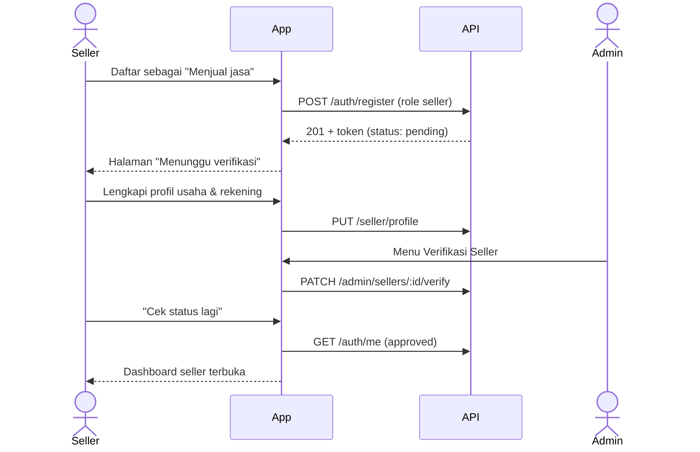
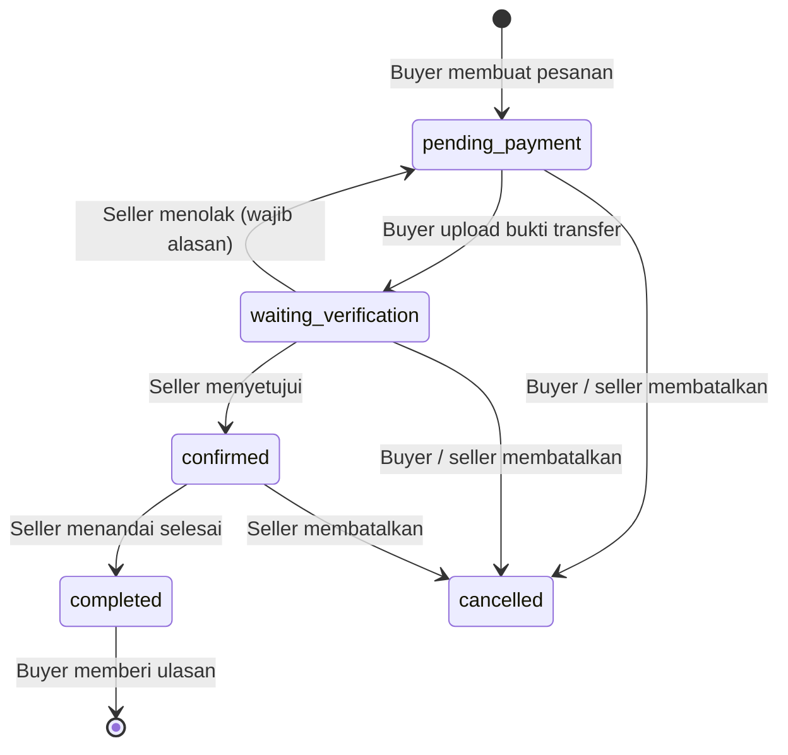

# Alur kerja aplikasi Vita Travel

Vita Travel adalah marketplace untuk UMKM jasa travel. **Seller** (agen travel kecil atau pemandu
lokal) menjual **paket trip** dan **jasa pemandu**. **Buyer** memesan dan membayar lewat transfer
bank. **Admin** menjaga kualitas platform.

## Role dan hak akses

| Fitur                                                       | Buyer | Seller | Admin |
| ----------------------------------------------------------- | :---: | :----: | :---: |
| Lihat & cari listing                                        |   ✓   |   ✓    |   ✓   |
| Favorit (wishlist)                                          |   ✓   |        |       |
| Buat pesanan, upload bukti transfer, batalkan, beri ulasan  |   ✓   |        |       |
| CRUD listing milik sendiri (setelah diverifikasi)           |       |   ✓    |       |
| Verifikasi bukti transfer, tandai selesai, batalkan pesanan |       |   ✓    |       |
| Laporan penjualan                                           |       |   ✓    |       |
| Verifikasi seller, CRUD kategori & destinasi                |       |        |   ✓   |
| Tangguhkan / pulihkan listing, nonaktifkan user             |       |        |   ✓   |

Pembatasan dilakukan dua kali: **di backend** (middleware `verifyToken`, `allowRoles`,
`approvedSellerOnly`, pengecekan pemilik data) dan **di app** (`lib/screens/role_home.dart` membuka
halaman utama sesuai role; tombol di halaman bersama menyesuaikan role).

## Alur utama

### 1. Registrasi & verifikasi seller



### 2. Status pesanan



| Status                 | Label di app        | Warna       |
| ---------------------- | ------------------- | ----------- |
| `pending_payment`      | Menunggu Pembayaran | amber       |
| `waiting_verification` | Menunggu Verifikasi | biru langit |
| `confirmed`            | Dikonfirmasi        | hijau       |
| `completed`            | Selesai             | putih 60%   |
| `cancelled`            | Dibatalkan          | merah       |

### 3. Aturan pemesanan (dicek di `booking.controller.js`)

- **Paket trip**: tanggal berangkat ditentukan seller. Total = harga × jumlah peserta. Jumlah peserta
  tidak boleh melebihi sisa kursi (`409`). Pengecekan memakai transaksi + `SELECT … FOR UPDATE`
  supaya dua buyer yang memesan bersamaan tidak membuat kursi minus.
- **Jasa pemandu**: buyer memilih tanggal mulai dan jumlah hari. Total = harga × jumlah hari. Jumlah
  orang ≤ ukuran grup. Pemandu tidak bisa dipesan pada tanggal yang bertabrakan (`409`).
- Rekening tujuan transfer diambil dari profil usaha seller.

## Struktur kode

### Backend (`backend/`)

```
database/schema.sql     DDL: tabel, ENUM, PK, FK, CHECK
database/seed.js        DML: akun uji & data contoh
database/setup.js       npm run db:setup (buat database → schema → seed)
src/server.js           menjalankan server
src/app.js              daftar middleware & routes
src/config.js           membaca .env
src/db.js               koneksi PostgreSQL + helper transaksi
src/validators.js       aturan validasi input (zod)
src/middleware/         auth (token & role), upload, validate, errorHandler
src/routes/             peta URL → controller
src/controllers/        logika + query SQL setiap fitur
tests/api.test.js       test otomatis (npm test)
```

### Mobile (`mobile/lib/`)

```
main.dart               titik awal app, Provider, tema
config.dart             alamat API
theme/app_theme.dart    design system: warna, tipografi, spasi, radius, ThemeData
models/                 class data + fromJson (User, Listing, Booking, ...)
services/               fungsi pemanggil endpoint API (ApiService = helper HTTP)
providers/              state global: AuthProvider (sesi login), WishlistProvider
widgets/                komponen UI yang dipakai berulang
screens/auth/           splash, login, register
screens/buyer/          beranda, jelajah, favorit, form pesan, upload bukti, ulasan
screens/seller/         dashboard, listing, form listing, laporan, profil usaha
screens/admin/          dashboard, verifikasi seller, kategori, destinasi, moderasi, user
screens/shared/         detail listing, daftar & detail pesanan, profil (semua role)
```

Alur data di app: **Screen → Service → ApiService → REST API**, hasilnya diubah menjadi model
(`Listing.fromJson`) lalu ditampilkan. Data yang dipakai banyak halaman (user yang login, daftar
favorit) disimpan di **Provider**.
