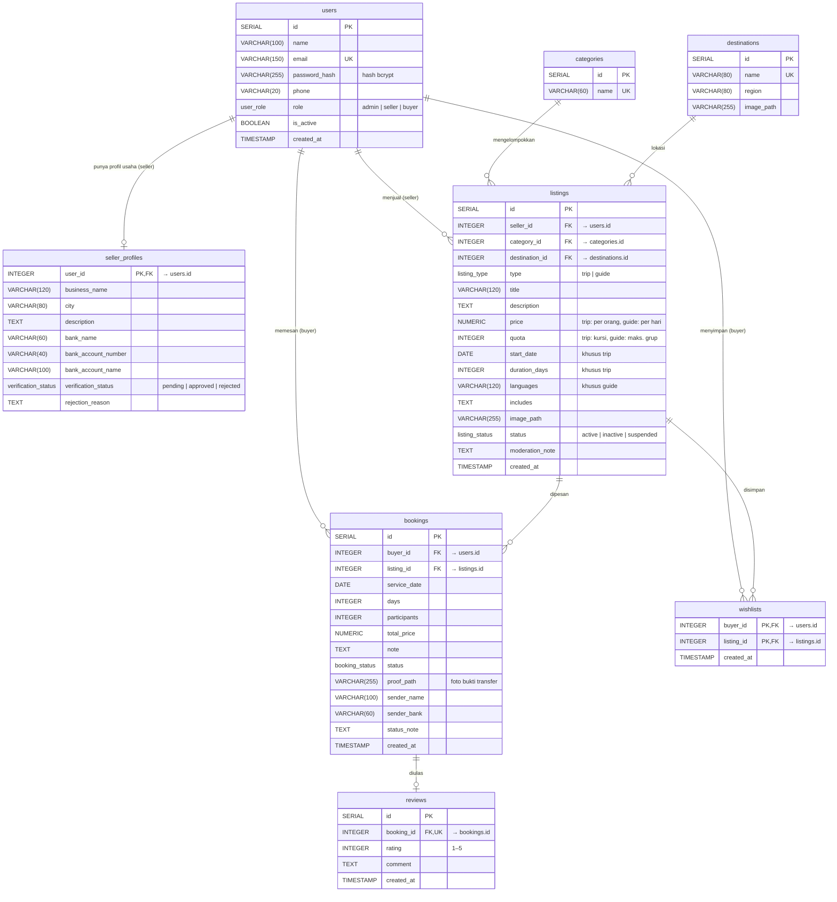

# ERD — Database `vita_travel`

Database: **PostgreSQL**. Struktur dibuat oleh [`backend/database/schema.sql`](../backend/database/schema.sql)
(DDL), data contoh oleh [`backend/database/seed.js`](../backend/database/seed.js) (DML).
Gambar ERD: [`erd.svg`](erd.svg).

## Penjelasan tabel

| Tabel             | Fungsi                                                       | Kunci & relasi                                                         |
| ----------------- | ------------------------------------------------------------ | ---------------------------------------------------------------------- |
| `users`           | Akun login semua role. Role disimpan di kolom `role` (ENUM). | PK `id`, email UNIQUE                                                  |
| `seller_profiles` | Data usaha & rekening seller, status verifikasi admin.       | PK sekaligus FK `user_id` → relasi **1:1** dengan `users`              |
| `categories`      | Tema listing (Retreat, Petualangan, …). Dikelola admin.      | PK `id`, nama UNIQUE                                                   |
| `destinations`    | Lokasi tujuan + foto. Dikelola admin.                        | PK `id`, nama UNIQUE                                                   |
| `listings`        | **Data utama 1**: paket trip / jasa pemandu milik seller.    | FK ke `users`, `categories`, `destinations` (**N:1**)                  |
| `bookings`        | **Data utama 2**: pesanan buyer + bukti transfer.            | FK ke `users` (buyer) & `listings` (**N:1**)                           |
| `reviews`         | Rating & ulasan, maksimal satu per pesanan.                  | FK `booking_id` UNIQUE → **1:1** dengan `bookings`                     |
| `wishlists`       | Listing favorit buyer.                                       | PK gabungan (`buyer_id`, `listing_id`) → relasi **N:M** users–listings |

## Aturan integritas data

- **ON DELETE RESTRICT** pada `listings.category_id`, `listings.destination_id`, dan
  `bookings.listing_id`: kategori/destinasi yang masih dipakai listing, atau listing yang sudah punya
  pesanan, tidak bisa dihapus (API membalas `409 Conflict`).
- **ON DELETE CASCADE** pada `seller_profiles`, `wishlists`, `reviews`: data turunan ikut terhapus
  bersama induknya.
- **CHECK**: `price > 0`, `quota > 0`, `rating BETWEEN 1 AND 5`, dan paket trip wajib punya
  `start_date` + `duration_days`.
- **ENUM** membatasi nilai `role`, `status` listing, `status` pesanan, dan status verifikasi.
- Password disimpan sebagai **hash bcrypt** (`password_hash`), bukan teks asli.
- Gambar disimpan sebagai file di folder `backend/uploads/`; database hanya menyimpan path-nya
  (`image_path`, `proof_path`).
