# SOFTWARE REQUIREMENTS SPECIFICATION (SRS)
# VITA TRAVEL
## Marketplace Jasa Travel Berbasis UMKM

---

| Item | Keterangan |
| --- | --- |
| Nama Sistem | Vita Travel |
| Jenis Dokumen | Software Requirements Specification (SRS) |
| Satuan Pendidikan | SMK Taruna Bhakti |
| Kompetensi Keahlian | Rekayasa Perangkat Lunak |
| Tahun Pelajaran | 2026/2027 |
| Mata Pelajaran | KOKE (Konsentrasi Keahlian) |
| Level | Medium |
| Bentuk Soal | Individu |
| Penyusun | Fahri |
| Tanggal Penyusunan | 15 November 2026 |
| Versi Dokumen | 1.3 |
| Repositori | `https://github.com/fahrizaza/Vita-Travel` |
| Website Daring | `https://vita-travel.netlify.app` (rincian pada Bab IV.5.5) |
| Basis Data Daring | Aiven for PostgreSQL (rincian pada Bab IV.5.3) |

---

# BAB I PENDAHULUAN

## 1.1 Latar Belakang

Sektor Usaha Mikro, Kecil, dan Menengah (UMKM) di Indonesia menyerap sebagian besar tenaga kerja
nasional, namun pemanfaatan teknologi digitalnya masih belum merata. Salah satu bidang UMKM yang
tertinggal secara digital adalah **jasa travel skala kecil**: agen perjalanan rumahan, penyelenggara
retreat, dan pemandu wisata lokal.

Berdasarkan pengamatan terhadap cara kerja pelaku usaha tersebut, ditemukan beberapa masalah nyata:

1. **Pemasaran masih manual.** Penawaran paket trip dan jasa pemandu disebarkan lewat unggahan media
   sosial dan pesan pribadi. Tidak ada katalog terpusat, sehingga calon pembeli sulit membandingkan
   pilihan dan pemilik usaha harus mengirim ulang daftar paket setiap kali ditanya.
2. **Pemesanan tidak tercatat rapi.** Pesanan masuk melalui percakapan WhatsApp. Jumlah kursi yang
   tersisa dihitung manual, sehingga sering terjadi pesanan melebihi kuota atau pemandu terpesan pada
   tanggal yang sama untuk dua pelanggan berbeda.
3. **Pembayaran sulit dilacak.** Pembayaran dilakukan dengan transfer bank manual. Bukti transfer
   dikirim sebagai foto di percakapan pribadi, terpisah dari data pesanan, sehingga pemilik usaha harus
   mencocokkan sendiri antara foto, nominal, dan nama pemesan.
4. **Tidak ada rekam jejak kualitas.** Ulasan pelanggan hanya beredar di kolom komentar media sosial
   dan tidak melekat pada paket yang dijual, sehingga calon pembeli tidak punya dasar untuk menilai
   kualitas penyelenggara.
5. **Pemilik usaha kesulitan melihat performa.** Tidak ada laporan penjualan. Pemilik usaha tidak bisa
   mengetahui paket mana yang paling laku atau berapa pendapatan beberapa bulan terakhir.

Kelima masalah tersebut berakar pada satu hal yang sama: **proses bisnis yang masih tersebar dan tidak
terdokumentasi**. Diperlukan sebuah sistem terpadu yang menyatukan katalog, pemesanan, verifikasi
pembayaran, ulasan, dan pelaporan dalam satu tempat.

Vita Travel dibangun sebagai jawaban atas kebutuhan tersebut. Sistem ini adalah **marketplace jasa
travel** yang mempertemukan dua pihak UMKM: **seller** (agen travel kecil dan pemandu lokal yang
menjual paket) dan **buyer** (pelanggan yang memesan). Sistem dijalankan oleh **admin** yang menjaga
kualitas platform melalui verifikasi penjual dan moderasi isi.

## 1.2 Rumusan Masalah

Berdasarkan latar belakang di atas, rumusan masalah dalam pengembangan sistem ini adalah:

1. Bagaimana merancang sistem yang mampu menampilkan katalog paket trip dan jasa pemandu lokal
   secara terpusat, sehingga calon pembeli dapat mencari dan membandingkan pilihan tanpa harus
   bertanya langsung kepada penjual?
2. Bagaimana merancang alur pemesanan yang dapat menghitung total biaya secara otomatis dan mencegah
   terjadinya pemesanan melebihi kuota kursi atau bentrok jadwal pemandu?
3. Bagaimana merancang alur verifikasi pembayaran transfer bank yang menyatukan bukti transfer dengan
   data pesanan yang bersangkutan?
4. Bagaimana menerapkan autentikasi dan otorisasi tiga peran pengguna sehingga setiap pengguna hanya
   dapat mengakses fitur sesuai haknya, dan seller baru dapat berjualan setelah diverifikasi?
5. Bagaimana merancang basis data yang menjaga integritas hubungan antar data, sehingga pesanan tidak
   dapat menghapus listing yang masih dipakai dan kategori yang masih dipakai tidak dapat dihapus?
6. Bagaimana menyediakan kanal bagi pemilik usaha untuk memantau performa penjualannya sendiri?
7. Bagaimana merancang aplikasi mobile yang dapat dipakai pemilik usaha dan pembeli dari perangkat
   masing-masing sebagai antarmuka utama sistem?

## 1.3 Tujuan Penulisan Dokumen

Dokumen SRS ini disusun dengan tujuan:

1. **Mendefinisikan kebutuhan sistem secara lengkap dan terukur.** Menjabarkan seluruh kebutuhan
   fungsional dan non-fungsional Vita Travel sebagai acuan tunggal bagi pengembangan.
2. **Menjadi dasar kesepakatan antara pengembang dan penguji.** Dokumen ini menjelaskan apa yang
   dibangun dan sejauh mana sistem dinyatakan memenuhi kebutuhan, sehingga proses pengujian memiliki
   dasar yang objektif dan bukan penilaian pribadi.
3. **Mendokumentasikan keputusan perancangan beserta alasannya.** Setiap keputusan penting — pemilihan
   metode pengembangan, struktur basis data, aturan bisnis, dan pembagian peran — dicatat berikut
   alasan di baliknya, agar dapat dipahami kembali di kemudian hari.
4. **Menjadi acuan pengujian dan penerimaan sistem.** Daftar kebutuhan fungsional diberi kode unik
   (FR-xx) dan kebutuhan non-fungsional (NFR-xx) sehingga setiap butir dapat ditelusuri ke hasil
   pengujiannya pada Bab IV.
5. **Menjadi dasar pengembangan lanjutan.** Menandai secara jujur batas kemampuan sistem saat ini dan
   hal-hal yang belum dikerjakan, sehingga pengembangan berikutnya memiliki titik awal yang jelas.

---

# BAB II METODE PENGEMBANGAN

## 2.1 Metode Pengembangan

### 2.1.1 Model yang Dipilih

Sistem Vita Travel dikembangkan dengan metode **Agile** menggunakan kerangka kerja **Scrum** dalam
bentuk iterasi pendek (sprint harian).

### 2.1.2 Alasan Pemilihan

Pemilihan Agile-Scrum didasarkan pada tiga pertimbangan yang spesifik terhadap proyek ini:

**Pertama, kebutuhan sistem berkembang saat pengerjaan berjalan.** Pada tahap awal, ruang lingkup
hanya mencakup katalog dan pemesanan. Saat alur diperiksa, muncul kebutuhan yang tidak terpikirkan di
awal namun krusial bagi bisnis, yaitu **verifikasi penjual** (agar platform tidak diisi penjual
fiktif), **moderasi listing** (agar admin dapat menindak isi yang tidak pantas), dan **laporan
penjualan** (agar seller dapat melihat performa). Model Waterfall yang mengunci kebutuhan di awal akan
memaksa perubahan besar di tengah proses karena fitur-fitur tersebut menuntut tambahan tabel dan
endpoint. Agile mengizinkan penyisipan kebutuhan baru dan penyesuaian rancangan di iterasi berikutnya
tanpa membongkar keseluruhan sistem.

**Kedua, pengerjaan dilakukan oleh satu orang dengan waktu terbatas.** Alur kerja Scrum yang memecah
pekerjaan menjadi bagian kecil memungkinkan penyelesaian dilakukan bertahap dan setiap tahap dapat
langsung diuji. Fitur yang sudah selesai dapat dibuktikan berjalan sebelum melanjutkan ke fitur
berikutnya, sehingga tidak ada risiko menemukan cacat besar di akhir pengerjaan.

**Ketiga, umpan balik dapat diperoleh cepat.** Arena sistem ini adalah alur bisnis (memesan, membayar,
memverifikasi), kesalahan rancangan paling mudah ditemukan dengan mencoba langsung alurnya dari sisi
pengguna. Iterasi pendek memungkinkan setiap alur dijalankan dan diperbaiki berulang kali sampai
benar-benar sesuai.

### 2.1.3 Perbandingan dengan Alternatif Lain

| Aspek | Waterfall | **Agile-Scrum (dipilih)** | V-Model |
| --- | --- | --- | --- |
| Perubahan kebutuhan | Sulit, harus mundur ke tahap awal | Diterima di setiap iterasi | Sulit, terikat pasangan uji |
| Penyerahan hasil | Sekali di akhir | Bertahap per fitur | Sekali di akhir |
| Kesesuaian waktu terbatas | Kurang, tahap mengunci satu sama lain | **Baik, dapat berhenti di fitur yang selesai** | Kurang |
| Kesesuaian dengan proyek 1 orang | Sedang | **Baik, tidak butuh banyak koordinasi tim** | Kurang |
| Kesesuaian kebutuhan yang berkembang | Rendah | **Tinggi** | Rendah |

### 2.1.4 Tahapan Kerja yang Dijalankan

| Tahap | Kegiatan | Keluaran |
| --- | --- | --- |
| 1. Analisis kebutuhan | Mengidentifikasi peran pengguna, alur bisnis pesanan, dan aturan pembatasan akses | Rumusan masalah, daftar peran, alur kerja |
| 2. Perancangan | Menyusun ERD dan skema tabel, merancang kontrak API, merancang struktur halaman aplikasi | `schema.sql`, `docs/ERD.md`, `docs/API.md` |
| 3. Implementasi bertahap | Mengerjakan modul secara berurutan: autentikasi → katalog → listing seller → pesanan → admin | Berkas kode tiap modul |
| 4. Pengujian | Menjalankan uji otomatis API dan widget, uji blackbox alur lengkap, uji tampilan di beberapa ukuran layar | Hasil uji, Bab IV |
| 5. Dokumentasi | Menyusun dokumentasi teknis dan dokumen SRS ini | `README.md`, `docs/ALUR.md`, dokumen ini |

## 2.2 Jadwal Pengembangan Sistem

### 2.2.1 Diagram Jadwal

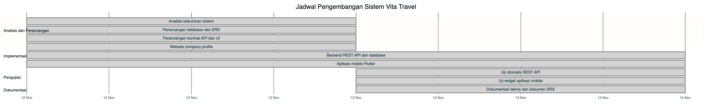

### 2.2.2 Tabel Rincian Jadwal

| No | Tahap | Kegiatan | Mulai | Selesai | Durasi | Status |
| --- | --- | --- | --- | --- | --- | --- |
| 1 | Analisis | Identifikasi peran, alur bisnis, dan aturan akses | 12 Nov 2026 | 12 Nov 2026 | 1 hari | Selesai |
| 2 | Perancangan | Perancangan basis data, ERD, dan kamus data | 12 Nov 2026 | 12 Nov 2026 | 1 hari | Selesai |
| 3 | Perancangan | Perancangan kontrak REST API dan pemetaan endpoint | 12 Nov 2026 | 12 Nov 2026 | 1 hari | Selesai |
| 4 | Implementasi | Website company profile (Vite + React) | 12 Nov 2026 | 12 Nov 2026 | 1 hari | Selesai |
| 5 | Implementasi | Backend REST API, autentikasi, dan basis data | 12 Nov 2026 | 13 Nov 2026 | 2 hari | Selesai |
| 6 | Implementasi | Aplikasi mobile Flutter (buyer, seller, admin) | 12 Nov 2026 | 13 Nov 2026 | 2 hari | Selesai |
| 7 | Pengujian | Uji otomatis REST API (22 kasus) | 13 Nov 2026 | 13 Nov 2026 | 1 hari | Selesai |
| 8 | Pengujian | Uji widget dan logika aplikasi mobile (10 kasus) | 13 Nov 2026 | 13 Nov 2026 | 1 hari | Selesai |
| 9 | Pengujian | Uji blackbox alur lengkap melalui HTTP (42 kasus) | 13 Nov 2026 | 13 Nov 2026 | 1 hari | Selesai |
| 10 | Dokumentasi | Dokumentasi teknis (`README`, `ALUR`, `API`, `ERD`) | 13 Nov 2026 | 13 Nov 2026 | 1 hari | Selesai |
| 11 | Dokumentasi | Penyusunan dokumen SRS ini | 14 Nov 2026 | 14 Nov 2026 | 1 hari | Selesai |
| 12 | Pengelolaan versi | Inisialisasi repositori Git dan penyusunan cabang | 15 Nov 2026 | 15 Nov 2026 | 1 hari | Selesai |
| 13 | Penyebaran | Deploy basis data ke Aiven | 15 Nov 2026 | 15 Nov 2026 | 1 hari | Selesai |
| 14 | Penyebaran | Deploy website ke Netlify | 15 Nov 2026 | 15 Nov 2026 | 1 hari | Selesai |
| 15 | Penyebaran | Deploy REST API dan aplikasi mobile | — | — | — | Belum dijalankan |

### 2.2.3 Catatan Pelaksanaan

Jadwal di atas disusun berdasarkan keterangan waktu berkas (mtime) yang benar-benar tercatat pada
proyek. Pekerjaan berlangsung dalam rentang **12 November 2026 pukul 17.40** hingga
**13 November 2026 pukul 06.55**, dilanjutkan penyusunan dokumen pada 14 November 2026 dan
penyusunan repositori Git pada 15 November 2026. Karena pengerjaan bersifat iteratif, tahap pengujian
tidak menunggu seluruh implementasi selesai: setiap modul diuji begitu modul tersebut selesai
dikerjakan.

Baris 13 dan 14 berstatus **selesai** karena basis data sudah berjalan di Aiven dan website sudah
berjalan di Netlify; keduanya diuji dengan cara yang berbeda sesuai sifatnya — basis data diperiksa
isinya, website diperiksa tampilannya di peramban. Baris 15 sengaja dibiarkan berstatus **belum
dijalankan** agar pembaca dokumen dapat melihat bahwa tahap penyebaran belum seluruhnya tertutup,
bukan menghilangkannya dari rencana.

---

# BAB III ANALISIS KEBUTUHAN SISTEM

## 3.1 Nama Sistem

| Item | Keterangan |
| --- | --- |
| Nama Sistem | **Vita Travel** |
| Jenis Sistem | Marketplace (pasar daring) jasa travel |
| Bidang UMKM | Jasa perjalanan: agen trip skala kecil dan pemandu wisata lokal |
| Slogan | Menghubungkan pelaku jasa travel lokal dengan pelanggannya |
| Basis Teknologi | Node.js + Express (backend), PostgreSQL (basis data), Flutter (mobile), React (web) |
| Nama Basis Data | `vita_travel` |

Nama "Vita" diambil dari kata *vita* yang berarti "kehidupan", menggambarkan misi sistem untuk
menghidupkan kembali usaha jasa travel kecil yang selama ini berjalan tanpa dukungan teknologi.

## 3.2 Ruang Lingkup

### 3.2.1 Deskripsi Sistem

Vita Travel adalah sebuah **marketplace jasa travel** yang berfungsi sebagai perantara antara pelaku
UMKM jasa perjalanan dengan pelanggannya. Sistem ini memiliki tiga jenis pengguna yang saling
berhubungan:

**Seller** adalah agen travel skala kecil atau pemandu wisata lokal yang memiliki produk untuk dijual.
Seller dapat menjual dua jenis layanan: **paket trip** (perjalanan dengan tanggal keberangkatan dan
durasi yang ditentukan) dan **jasa pemandu** (layanan pemanduan yang tanggalnya dipilih oleh pembeli).
Untuk dapat mulai berjualan, seller harus mendaftar, melengkapi data usaha dan rekening bank, lalu
menunggu verifikasi dari admin.

**Buyer** adalah pelanggan yang mencari, memesan, dan membayar paket yang dijual seller. Buyer memilih
paket, membuat pesanan, mentransfer biaya secara manual ke rekening seller, mengunggah bukti transfer,
lalu menunggu seller memverifikasi pembayaran tersebut. Setelah perjalanan selesai, buyer dapat
memberikan rating dan ulasan.

**Admin** adalah pengelola platform yang menjaga kualitas dan ketertiban. Admin memverifikasi pengajuan
seller, mengelola data kategori dan destinasi, menindak listing yang melanggar, dan dapat menonaktifkan
akun pengguna yang bermasalah.

Sistem diakses melalui dua antarmuka: **aplikasi mobile Flutter** yang menjadi antarmuka utama untuk
ketiga peran, dan **website company profile** berbasis React yang memperkenalkan perusahaan secara
publik.

### 3.2.2 Manfaat Sistem

| Pihak | Manfaat |
| --- | --- |
| **Seller (UMKM jasa travel)** | Memperoleh katalog daring tanpa perlu membangun situs sendiri; pesanan tercatat otomatis; kuota kursi terkontrol; bukti transfer tersimpan menyatu dengan data pesanan; tersedia laporan penjualan bulanan dan daftar listing terlaris. |
| **Buyer (pelanggan)** | Dapat mencari dan membandingkan paket secara terpusat; melihat rating dan ulasan nyata dari pembeli sebelumnya; alur pemesanan yang jelas; riwayat pesanan tersimpan; dapat menyimpan paket favorit. |
| **Pemandu wisata lokal** | Memperoleh kanal penghasilan tambahan atas jasa pemanduan, dengan jadwal yang otomatis terhindar dari bentrok. |
| **Admin / pemilik platform** | Memiliki kendali atas kualitas isi melalui verifikasi seller dan moderasi listing; dapat memantau statistik platform. |
| **Industri pariwisata** | Mendorong digitalisasi pelaku usaha kecil, memperluas jangkauan pasar mereka di luar jaringan sosial terdekat. |

### 3.2.3 Batas Ruang Lingkup

Sistem ini **mencakup**: manajemen akun dan sesi login, katalog dan pencarian listing, pengelolaan
listing oleh seller, alur pemesanan hingga ulasan, unggah gambar, verifikasi seller, moderasi isi,
serta pelaporan penjualan.

Sistem ini **tidak mencakup**: pemrosesan pembayaran daring otomatis (payment gateway) — pembayaran
dilakukan manual melalui transfer bank; perhitungan pajak dan faktur resmi; fitur obrolan langsung
antara buyer dan seller di dalam aplikasi; serta sistem pengembalian dana otomatis.

## 3.3 Kebutuhan Fungsional

### 3.3.1 Fitur Utama

Sistem dibagi menjadi tujuh modul fungsional. Setiap kebutuhan diberi kode unik untuk keperluan
penelusuran pada tahap pengujian.

#### A. Modul Autentikasi dan Akun (FR-01 – FR-08)

| Kode | Kebutuhan Fungsional |
| --- | --- |
| FR-01 | Sistem menyediakan pendaftaran akun dengan data nama, email, nomor HP, password, dan pilihan peran (buyer atau seller). |
| FR-02 | Sistem mewajibkan calon seller mengisi nama usaha dan kota pada saat pendaftaran. |
| FR-03 | Sistem menyimpan password dalam bentuk hash bcrypt dan tidak pernah menyimpan atau mengembalikan password asli. |
| FR-04 | Sistem menolak pendaftaran dengan email yang sudah terdaftar dengan kode 409. |
| FR-05 | Sistem menyediakan login yang mengembalikan token JWT berlaku 7 hari bagi pengguna yang berhasil diautentikasi. |
| FR-06 | Sistem menolak login bagi akun yang dinonaktifkan admin dengan kode 403. |
| FR-07 | Pengguna yang sudah login dapat mengubah nama dan nomor HP pada profilnya. |
| FR-08 | Pengguna yang sudah login dapat mengganti password dengan memverifikasi password lama. |

#### B. Modul Katalog Publik (FR-09 – FR-13)

| Kode | Kebutuhan Fungsional |
| --- | --- |
| FR-09 | Sistem menampilkan daftar listing yang dapat diakses tanpa login. |
| FR-10 | Daftar listing hanya menampilkan listing berstatus aktif milik seller yang telah diverifikasi. |
| FR-11 | Pengunjung dapat mencari listing berdasarkan kata kunci pada judul dan deskripsi. |
| FR-12 | Pengunjung dapat menyaring listing berdasarkan jenis (trip/guide), kategori, destinasi, dan rentang harga, serta mengurutkannya berdasarkan terbaru, rating, atau harga. |
| FR-13 | Pengunjung dapat melihat halaman detail listing yang memuat deskripsi lengkap, fasilitas, harga, sisa kuota, data seller, dan 20 ulasan terbaru. |

#### C. Modul Pengelolaan Listing oleh Seller (FR-14 – FR-20)

| Kode | Kebutuhan Fungsional |
| --- | --- |
| FR-14 | Seller yang telah diverifikasi dapat menambah listing baru berupa paket trip atau jasa pemandu, dilengkapi foto. |
| FR-15 | Sistem mewajibkan paket trip mengisi tanggal keberangkatan dan durasi perjalanan. |
| FR-16 | Sistem mewajibkan jasa pemandu mengisi bahasa yang dikuasai. |
| FR-17 | Seller dapat mengubah data listing miliknya sendiri, dengan atau tanpa mengganti foto. |
| FR-18 | Seller dapat menghapus listing miliknya, kecuali listing yang sudah memiliki pesanan. |
| FR-19 | Sistem menolak seller mengubah atau menghapus listing milik seller lain dengan kode 403. |
| FR-20 | Seller yang belum diverifikasi admin tidak dapat menambah atau mengubah listing (kode 403). |

#### D. Modul Pesanan (FR-21 – FR-30)

| Kode | Kebutuhan Fungsional |
| --- | --- |
| FR-21 | Buyer dapat membuat pesanan atas suatu listing dengan mengisi jumlah peserta dan catatan opsional. |
| FR-22 | Sistem menghitung total biaya secara otomatis: untuk paket trip sebesar harga dikali jumlah peserta, untuk jasa pemandu sebesar harga dikali jumlah hari. |
| FR-23 | Sistem menolak pesanan yang jumlah pesertanya melebihi sisa kuota dengan kode 409. |
| FR-24 | Untuk jasa pemandu, buyer memilih tanggal mulai dan jumlah hari, dan sistem menolak pemesanan pada tanggal yang bertabrakan dengan pesanan lain. |
| FR-25 | Sistem mencegah terjadinya pemesanan berlebih pada saat dua buyer memesan bersamaan dengan menggunakan transaksi basis data dan penguncian baris. |
| FR-26 | Buyer dapat mengunggah bukti transfer beserta nama pengirim dan nama bank, yang mengubah status pesanan menjadi menunggu verifikasi. |
| FR-27 | Seller dapat menyetujui bukti transfer (status menjadi dikonfirmasi) atau menolaknya dengan alasan wajib diisi (status kembali ke menunggu pembayaran). |
| FR-28 | Seller dapat menandai pesanan yang sudah dikonfirmasi sebagai selesai. |
| FR-29 | Buyer dan seller dapat membatalkan pesanan, dengan alasan wajib diisi bagi seller. |
| FR-30 | Buyer dapat memberikan rating 1–5 beserta ulasan, hanya untuk pesanan berstatus selesai dan hanya satu kali per pesanan. |

#### E. Modul Favorit (FR-31 – FR-33)

| Kode | Kebutuhan Fungsional |
| --- | --- |
| FR-31 | Buyer dapat menyimpan listing ke daftar favorit. |
| FR-32 | Buyer dapat menghapus listing dari daftar favorit. |
| FR-33 | Buyer dapat melihat daftar seluruh listing favoritnya. |

#### F. Modul Admin (FR-34 – FR-40)

| Kode | Kebutuhan Fungsional |
| --- | --- |
| FR-34 | Admin dapat melihat dan menyaring daftar pengajuan seller berdasarkan status verifikasi. |
| FR-35 | Admin dapat menyetujui atau menolak pengajuan seller, dengan alasan wajib diisi bila ditolak. |
| FR-36 | Admin dapat menambah, mengubah, dan menghapus kategori listing. |
| FR-37 | Admin dapat menambah, mengubah, dan menghapus destinasi beserta fotonya. |
| FR-38 | Sistem menolak penghapusan kategori atau destinasi yang masih dipakai listing dengan kode 409. |
| FR-39 | Admin dapat menangguhkan listing beserta alasannya, sehingga listing tersebut hilang dari pencarian publik, dan dapat memulihkannya kembali. |
| FR-40 | Admin dapat menonaktifkan dan mengaktifkan kembali akun pengguna, serta melihat statistik platform. |

#### G. Modul Aplikasi Mobile (FR-41 – FR-48)

| Kode | Kebutuhan Fungsional |
| --- | --- |
| FR-41 | Aplikasi menampilkan halaman login dan registrasi. |
| FR-42 | Aplikasi menyimpan token login sehingga pengguna tidak perlu masuk ulang setiap membuka aplikasi. |
| FR-43 | Aplikasi membuka halaman utama yang berbeda sesuai peran pengguna yang sedang login. |
| FR-44 | Aplikasi menampilkan daftar dan detail data utama (listing, pesanan, pengguna untuk admin). |
| FR-45 | Aplikasi menyediakan formulir untuk menambah dan mengubah data listing melalui perangkat. |
| FR-46 | Aplikasi menghapus data melalui dialog konfirmasi terlebih dahulu. |
| FR-47 | Aplikasi dapat memilih foto dari galeri atau kamera, memvalidasi tipe dan ukurannya sebelum diunggah, lalu menampilkan gambar hasil unggahan. |
| FR-48 | Aplikasi menampilkan pesan berhasil atau gagal pada setiap proses, serta membatasi tampilan dan aksi sesuai peran pengguna. |

### 3.3.2 Karakteristik Pengguna

| Peran | Tingkat Kemampuan Teknis | Frekuensi Pemakaian | Kebutuhan Utama | Hak Akses Ringkas |
| --- | --- | --- | --- | --- |
| **Pengunjung** | Rendah–sedang | Sesekali | Melihat penawaran tanpa harus mendaftar | Hanya membaca katalog publik |
| **Buyer** | Rendah–sedang | Sedang | Memesan perjalanan dengan mudah dan aman | Katalog, favorit, pesanan sendiri, ulasan |
| **Seller** | Sedang | Tinggi (harian) | Mengelola jualan dan memantau pesanan masuk | CRUD listing sendiri, verifikasi pembayaran, laporan |
| **Admin** | Tinggi | Sedang | Menjaga kualitas isi dan menangani pelanggaran | Seluruh data platform |

### 3.3.3 Kamus Data

Kamus data berikut menjelaskan setiap tabel beserta kolom, tipe data, dan keterangannya. Notasi
kunci: **PK** = Primary Key, **FK** = Foreign Key, **UK** = Unique Key.

#### Tabel `users` — Akun seluruh peran

| Kolom | Tipe | Kunci | Null | Default | Keterangan |
| --- | --- | --- | --- | --- | --- |
| id | SERIAL | PK | Tidak | urut | Identitas unik pengguna |
| name | VARCHAR(100) | | Tidak | | Nama lengkap pengguna |
| email | VARCHAR(150) | UK | Tidak | | Alamat email, dipakai untuk login |
| password_hash | VARCHAR(255) | | Tidak | | Hash bcrypt dari password |
| phone | VARCHAR(20) | | Ya | | Nomor HP format Indonesia |
| role | user_role | | Tidak | `buyer` | Peran: admin, seller, atau buyer |
| is_active | BOOLEAN | | Tidak | TRUE | Status akun, diatur admin |
| created_at | TIMESTAMP | | Tidak | NOW() | Waktu pendaftaran |

#### Tabel `seller_profiles` — Data usaha seller

| Kolom | Tipe | Kunci | Null | Default | Keterangan |
| --- | --- | --- | --- | --- | --- |
| user_id | INTEGER | PK, FK → users.id | Tidak | | Sekaligus identitas profil, relasi 1:1 |
| business_name | VARCHAR(120) | | Tidak | | Nama usaha yang ditampilkan |
| city | VARCHAR(80) | | Tidak | | Kota domisili usaha |
| description | TEXT | | Ya | | Penjelasan singkat tentang usaha |
| bank_name | VARCHAR(60) | | Ya | | Bank tujuan transfer |
| bank_account_number | VARCHAR(40) | | Ya | | Nomor rekening tujuan |
| bank_account_name | VARCHAR(100) | | Ya | | Nama pemilik rekening |
| verification_status | verification_status | | Tidak | `pending` | Status verifikasi admin |
| rejection_reason | TEXT | | Ya | | Alasan bila pengajuan ditolak |

#### Tabel `categories` — Kategori listing

| Kolom | Tipe | Kunci | Null | Default | Keterangan |
| --- | --- | --- | --- | --- | --- |
| id | SERIAL | PK | Tidak | urut | Identitas kategori |
| name | VARCHAR(60) | UK | Tidak | | Nama kategori, contoh: Retreat & Wellness |

#### Tabel `destinations` — Destinasi wisata

| Kolom | Tipe | Kunci | Null | Default | Keterangan |
| --- | --- | --- | --- | --- | --- |
| id | SERIAL | PK | Tidak | urut | Identitas destinasi |
| name | VARCHAR(80) | UK | Tidak | | Nama destinasi, contoh: Bali |
| region | VARCHAR(80) | | Tidak | | Wilayah, provinsi, atau negara |
| image_path | VARCHAR(255) | | Ya | | Path foto destinasi |

#### Tabel `listings` — Data utama 1: paket trip dan jasa pemandu

| Kolom | Tipe | Kunci | Null | Default | Keterangan |
| --- | --- | --- | --- | --- | --- |
| id | SERIAL | PK | Tidak | urut | Identitas listing |
| seller_id | INTEGER | FK → users.id | Tidak | | Seller pemilik listing |
| category_id | INTEGER | FK → categories.id | Tidak | | Kategori listing |
| destination_id | INTEGER | FK → destinations.id | Tidak | | Destinasi tujuan |
| type | listing_type | | Tidak | | Jenis: trip atau guide |
| title | VARCHAR(120) | | Tidak | | Judul penawaran |
| description | TEXT | | Tidak | | Deskripsi lengkap |
| price | NUMERIC(12,2) | | Tidak | | Harga; trip per orang, guide per hari |
| quota | INTEGER | | Tidak | | Trip: jumlah kursi; guide: maksimum orang per grup |
| start_date | DATE | | Ya | | Khusus trip: tanggal keberangkatan |
| duration_days | INTEGER | | Ya | | Khusus trip: lama perjalanan (hari) |
| languages | VARCHAR(120) | | Ya | | Khusus guide: bahasa yang dikuasai |
| includes | TEXT | | Ya | | Fasilitas, satu per baris |
| image_path | VARCHAR(255) | | Ya | | Path foto utama listing |
| status | listing_status | | Tidak | `active` | Status tayang listing |
| moderation_note | TEXT | | Ya | | Alasan bila ditangguhkan admin |
| created_at | TIMESTAMP | | Tidak | NOW() | Waktu listing dibuat |

#### Tabel `bookings` — Data utama 2: pesanan

| Kolom | Tipe | Kunci | Null | Default | Keterangan |
| --- | --- | --- | --- | --- | --- |
| id | SERIAL | PK | Tidak | urut | Identitas pesanan |
| buyer_id | INTEGER | FK → users.id | Tidak | | Buyer pemesan |
| listing_id | INTEGER | FK → listings.id | Tidak | | Listing yang dipesan |
| service_date | DATE | | Tidak | | Tanggal layanan dimulai |
| days | INTEGER | | Tidak | 1 | Jumlah hari layanan |
| participants | INTEGER | | Tidak | | Jumlah peserta |
| total_price | NUMERIC(14,2) | | Tidak | | Total biaya hasil perhitungan sistem |
| note | TEXT | | Ya | | Catatan dari buyer |
| status | booking_status | | Tidak | `pending_payment` | Status pesanan |
| proof_path | VARCHAR(255) | | Ya | | Path foto bukti transfer |
| sender_name | VARCHAR(100) | | Ya | | Nama pengirim pada bukti transfer |
| sender_bank | VARCHAR(60) | | Ya | | Bank pengirim |
| status_note | TEXT | | Ya | | Alasan penolakan bukti atau pembatalan |
| created_at | TIMESTAMP | | Tidak | NOW() | Waktu pesanan dibuat |

#### Tabel `reviews` — Ulasan buyer

| Kolom | Tipe | Kunci | Null | Default | Keterangan |
| --- | --- | --- | --- | --- | --- |
| id | SERIAL | PK | Tidak | urut | Identitas ulasan |
| booking_id | INTEGER | FK, UK → bookings.id | Tidak | | Satu ulasan per pesanan |
| rating | INTEGER | | Tidak | | Nilai 1 sampai 5 |
| comment | TEXT | | Ya | | Isi ulasan |
| created_at | TIMESTAMP | | Tidak | NOW() | Waktu ulasan dibuat |

#### Tabel `wishlists` — Daftar favorit buyer

| Kolom | Tipe | Kunci | Null | Default | Keterangan |
| --- | --- | --- | --- | --- | --- |
| buyer_id | INTEGER | PK, FK → users.id | Tidak | | Buyer pemilik daftar |
| listing_id | INTEGER | PK, FK → listings.id | Tidak | | Listing yang disimpan |
| created_at | TIMESTAMP | | Tidak | NOW() | Waktu disimpan |

#### Tipe ENUM

| Nama Tipe | Nilai | Dipakai Pada |
| --- | --- | --- |
| user_role | `admin`, `seller`, `buyer` | `users.role` |
| verification_status | `pending`, `approved`, `rejected` | `seller_profiles.verification_status` |
| listing_type | `trip`, `guide` | `listings.type` |
| listing_status | `active`, `inactive`, `suspended` | `listings.status` |
| booking_status | `pending_payment`, `waiting_verification`, `confirmed`, `completed`, `cancelled` | `bookings.status` |

### 3.3.4 Antarmuka Pengguna (User Interface)

#### A. Peta Halaman Aplikasi Mobile

| Halaman | Peran | Isi Utama |
| --- | --- | --- |
| Splash | Semua | Menentukan tujuan: login atau halaman utama sesuai peran |
| Login | Semua | Form email dan password |
| Registrasi | Semua | Form pendaftaran; memilih daftar sebagai buyer atau seller |
| Beranda | Buyer | Carousel foto, kotak pencarian, baris Paket Trip, Pemandu Lokal, Destinasi |
| Jelajah | Buyer | Daftar listing lengkap dengan penyaring dan pengurutan |
| Favorit | Buyer | Daftar listing yang disimpan |
| Pesanan | Buyer, Seller | Daftar pesanan; isinya berbeda menurut peran |
| Profil | Semua | Data akun, ubah profil, ganti password, keluar |
| Detail Listing | Semua | Foto besar, deskripsi, fasilitas, ulasan, tombol aksi sesuai peran |
| Form Pesanan | Buyer | Jumlah peserta, tanggal untuk pemandu, catatan, ringkasan biaya |
| Halaman Pembayaran | Buyer | Data rekening seller, unggah bukti transfer |
| Halaman Ulasan | Buyer | Pemberian rating bintang dan komentar |
| Dashboard Seller | Seller | Ringkasan pesanan masuk dan grafik pendapatan 6 bulan |
| Listing Saya | Seller | Daftar listing milik sendiri, tombol tambah, ubah, hapus |
| Form Listing | Seller | Form tambah dan ubah listing beserta unggah foto |
| Laporan Penjualan | Seller | Grafik pendapatan bulanan dan daftar listing terlaris |
| Profil Usaha | Seller | Data usaha, rekening, dan status verifikasi |
| Dashboard Admin | Admin | Statistik platform dan transaksi 6 bulan |
| Verifikasi Seller | Admin | Daftar pengajuan seller dan aksi menyetujui atau menolak |
| Kelola Kategori | Admin | Daftar kategori dan aksi tambah, ubah, hapus |
| Kelola Destinasi | Admin | Daftar destinasi beserta foto dan aksi pengelolaan |
| Moderasi Listing | Admin | Seluruh listing dengan aksi menangguhkan atau memulihkan |
| Kelola Pengguna | Admin | Daftar pengguna dengan aksi mengaktifkan atau menonaktifkan |

#### B. Tema dan Panduan Visual

Aplikasi mobile memakai satu tema gelap bernuansa teal yang diturunkan dari identitas website, dengan
ketentuan ukuran sebagai berikut.

| Aspek | Ketentuan |
| --- | --- |
| Warna latar | `#0D2E37` (teal gelap) |
| Warna aksen | `#FB9826` (oranye), dipakai untuk tombol utama dan harga |
| Warna status | Amber menunggu pembayaran, biru langit menunggu verifikasi, hijau dikonfirmasi, merah dibatalkan |
| Huruf | Plus Jakarta Sans, bobot 400/500/600/700 |
| Kontras | Seluruh warna teks memenuhi rasio kontras minimal 4,5:1 terhadap latar |
| Sudut | 2 piksel untuk tombol dan input, 4 piksel untuk kartu, 0 untuk foto penuh |
| Jarak tepi | 20 piksel |
| Target sentuh | Minimal 48 piksel |

#### C. Halaman Website Company Profile

Website React menampilkan 11 halaman: Beranda, Retreat, Coaches, Contacts, Privacy Policy, Terms and
Conditions, serta enam halaman detail paket perjalanan (Romania, Bali, Portugal, Maroko, Maroko
Fotografi, dan Toscana). Halaman 404 disediakan untuk alamat yang tidak dikenal.

### 3.3.5 Interaksi Antar Modul

Sistem tersusun atas empat lapisan yang saling berhubungan. Perubahan pada satu lapisan mengalir ke
lapisan berikutnya melalui antarmuka yang tetap.

| Lapisan | Berkas | Tanggung Jawab | Berhubungan Dengan |
| --- | --- | --- | --- |
| Antarmuka Mobile | `mobile/lib/screens/` | Menampilkan data dan menangkap masukan pengguna | Lapisan layanan mobile |
| Layanan Mobile | `mobile/lib/services/` | Mengubah data model menjadi permintaan HTTP dan sebaliknya | REST API |
| REST API | `backend/src/routes/` dan `controllers/` | Memvalidasi masukan, memeriksa hak akses, menjalankan aturan bisnis | Basis data |
| Basis Data | `backend/database/` | Menyimpan data dan menjaga integritas hubungan | — |

Interaksi antar modul di dalam REST API dijalankan berurutan pada setiap permintaan:

1. **CORS** membuka akses dari aplikasi mobile.
2. **Body parser** mengurai JSON atau form-data.
3. **Route** mencocokkan alamat permintaan dengan pengendali yang tepat.
4. **`verifyToken`** memastikan token JWT sah dan akun masih aktif (menghasilkan 401 atau 403).
5. **`allowRoles`** memeriksa apakah peran pengguna berhak atas endpoint tersebut (menghasilkan 403).
6. **`approvedSellerOnly`** memeriksa status verifikasi seller pada endpoint penambahan listing.
7. **`uploadImage`** memeriksa tipe dan ukuran berkas yang diunggah (menghasilkan 415 atau 413).
8. **`validate`** memeriksa seluruh isi masukan terhadap skema (menghasilkan 400 dengan rincian per field).
9. **Controller** menjalankan aturan bisnis dan query ke basis data.
10. **`errorHandler`** menangkap setiap kesalahan dan mengubahnya menjadi balasan JSON yang konsisten.

Hubungan antar modul yang perlu diperhatikan:

- Modul **pesanan** bergantung pada modul **listing**: pesanan hanya dapat dibuat atas listing berstatus
  aktif milik seller terverifikasi, dan kuota listing berkurang seiring bertambahnya pesanan.
- Modul **ulasan** bergantung pada modul **pesanan**: ulasan hanya sah bila pesanan berstatus selesai,
  dan setiap pesanan hanya dapat diulas satu kali.
- Modul **listing** bergantung pada modul **kategori** dan **destinasi** yang dikelola admin; keduanya
  tidak dapat dihapus selama masih dipakai listing.
- Modul **verifikasi seller** menjadi prasyarat modul **listing seller**: sebelum disetujui admin,
  seller belum dapat menambah listing.

### 3.3.6 Alur Bisnis

#### A. Alur Pemesanan dan Pembayaran

Alur ini adalah inti sistem: dari buyer memilih paket hingga perjalanan selesai dan diulas.

**Tahap 1 — Membuat pesanan.** Buyer membuka detail listing, mengisi jumlah peserta (dan tanggal
mulai serta jumlah hari bila memesan jasa pemandu), lalu sistem memvalidasi masukan, menghitung total
biaya, dan menyimpan pesanan dengan status menunggu pembayaran. Bila jumlah peserta melebihi sisa
kuota, pesanan ditolak dengan kode 409.

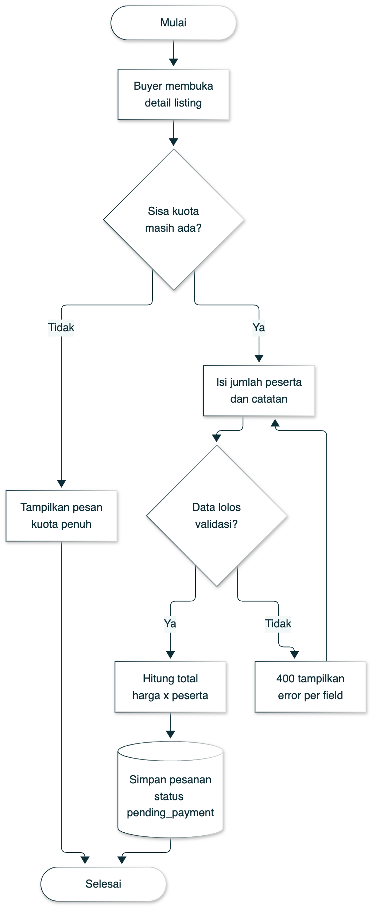

**Tahap 2 — Pembayaran dan verifikasi.** Buyer mentransfer biaya secara manual ke rekening seller yang
tercantum pada pesanan, lalu mengunggah foto bukti transfer beserta nama pengirim dan nama bank.
Status pesanan berubah menjadi menunggu verifikasi. Seller memeriksa bukti tersebut dan memutuskan
untuk menyetujui atau menolaknya; penolakan wajib disertai alasan, dan status pesanan kembali ke
menunggu pembayaran agar buyer dapat mengunggah bukti baru.

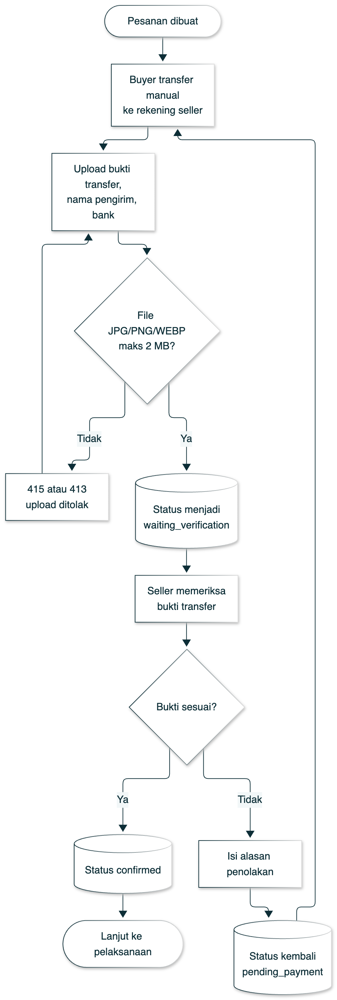

**Tahap 3 — Pelaksanaan dan ulasan.** Setelah pembayaran dikonfirmasi, perjalanan atau pemanduan
berlangsung. Seller menandai pesanan sebagai selesai, dan setelah itu buyer dapat memberikan rating
serta ulasan. Sistem menolak ulasan kedua atas pesanan yang sama dengan kode 409.

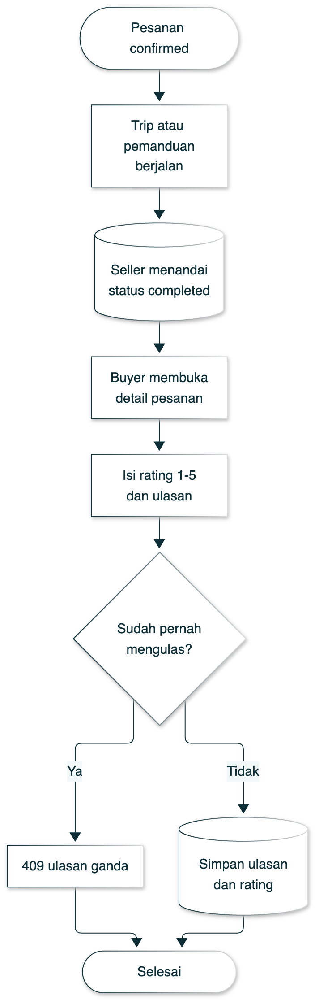

#### B. Alur Registrasi dan Verifikasi Seller

Alur ini menjaga agar hanya penjual yang benar-benar ada dan dapat diverifikasi yang boleh berjualan.

1. Calon seller mendaftar dengan mengisi data akun serta nama usaha dan kota.
2. Sistem memvalidasi masukan, meng-hash password, dan menyimpan akun dengan status pending.
3. Seller melengkapi profil usaha beserta data rekening bank tujuan transfer.
4. Seller mengajukan verifikasi; admin meninjau pengajuan tersebut.
5. Bila ditolak, admin wajib menuliskan alasan, dan seller dapat memperbaiki data lalu mengajukan
   ulang. Bila disetujui, status seller berubah menjadi terverifikasi.
6. Seller dapat membuka dashboard dan mulai mengelola listing. Selama belum diverifikasi, setiap
   upaya menambah listing ditolak dengan kode 403.

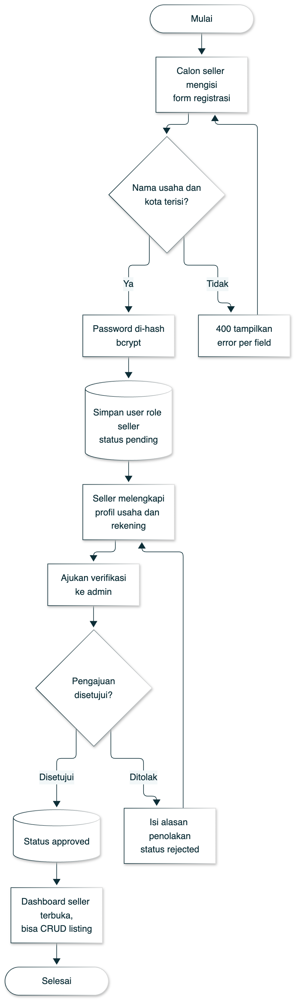

#### C. Alur Status Pesanan

Status pesanan bergerak mengikuti aturan yang tetap, dan perpindahan yang tidak sah ditolak sistem.

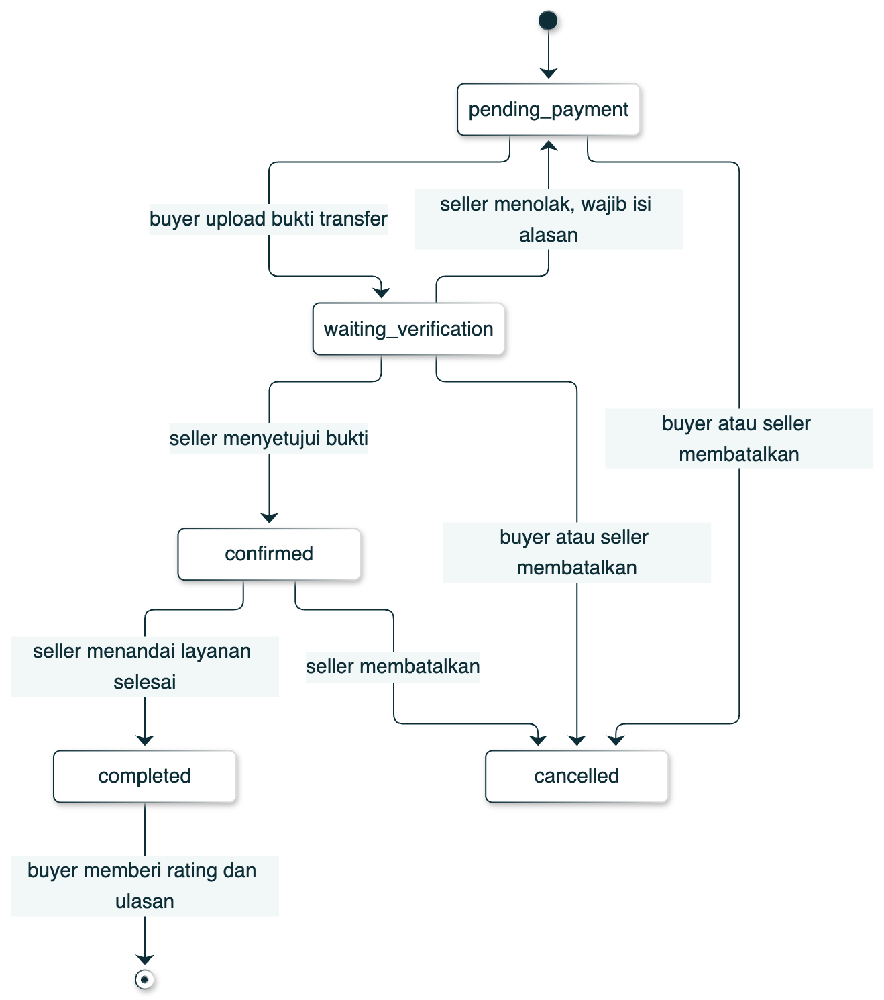

| Status | Label pada Aplikasi | Dapat Berpindah Ke |
| --- | --- | --- |
| `pending_payment` | Menunggu Pembayaran | `waiting_verification`, `cancelled` |
| `waiting_verification` | Menunggu Verifikasi | `confirmed`, `pending_payment`, `cancelled` |
| `confirmed` | Dikonfirmasi | `completed`, `cancelled` |
| `completed` | Selesai | (status akhir, dapat diulas) |
| `cancelled` | Dibatalkan | (status akhir) |

### 3.3.7 Daftar Endpoint REST API

Sistem menyediakan **39 endpoint** yang tersebar pada delapan berkas route. Kolom akses bertanda
`publik` berarti dapat diakses tanpa login.

#### A. Autentikasi — 5 endpoint

| Method | Endpoint | Akses | Keterangan |
| --- | --- | --- | --- |
| POST | `/auth/register` | publik | Mendaftar akun baru |
| POST | `/auth/login` | publik | Masuk dan memperoleh token |
| GET | `/auth/me` | semua login | Data pengguna yang sedang login |
| PUT | `/auth/me` | semua login | Ubah nama dan nomor HP |
| PUT | `/auth/password` | semua login | Ganti password |

#### B. Kategori — 4 endpoint

| Method | Endpoint | Akses | Keterangan |
| --- | --- | --- | --- |
| GET | `/categories` | publik | Daftar kategori beserta jumlah listing |
| POST | `/categories` | admin | Tambah kategori |
| PUT | `/categories/:id` | admin | Ubah nama kategori |
| DELETE | `/categories/:id` | admin | Hapus kategori (409 bila masih dipakai) |

#### C. Destinasi — 4 endpoint

| Method | Endpoint | Akses | Keterangan |
| --- | --- | --- | --- |
| GET | `/destinations` | publik | Daftar destinasi beserta URL foto |
| POST | `/destinations` | admin | Tambah destinasi beserta foto |
| PUT | `/destinations/:id` | admin | Ubah destinasi |
| DELETE | `/destinations/:id` | admin | Hapus destinasi (409 bila masih dipakai) |

#### D. Listing Publik — 2 endpoint

| Method | Endpoint | Akses | Keterangan |
| --- | --- | --- | --- |
| GET | `/listings` | publik | Daftar listing dengan pencarian, penyaring, dan pengurutan |
| GET | `/listings/:id` | publik | Detail listing beserta 20 ulasan terbaru |

#### E. Seller — 6 endpoint

| Method | Endpoint | Akses | Keterangan |
| --- | --- | --- | --- |
| PUT | `/seller/profile` | seller | Simpan profil usaha dan rekening |
| GET | `/seller/report` | seller | Laporan penjualan dan listing terlaris |
| GET | `/seller/listings` | seller | Daftar listing milik sendiri |
| POST | `/seller/listings` | seller terverifikasi | Tambah listing beserta foto |
| PUT | `/seller/listings/:id` | seller pemilik | Ubah listing |
| DELETE | `/seller/listings/:id` | seller pemilik | Hapus listing (409 bila sudah dipesan) |

#### F. Pesanan — 8 endpoint

| Method | Endpoint | Akses | Keterangan |
| --- | --- | --- | --- |
| GET | `/bookings` | semua login | Daftar pesanan sesuai peran |
| GET | `/bookings/:id` | pemilik data | Detail pesanan |
| POST | `/bookings` | buyer | Buat pesanan |
| PATCH | `/bookings/:id/payment` | buyer | Unggah bukti transfer |
| PATCH | `/bookings/:id/verify` | seller | Setujui atau tolak bukti |
| PATCH | `/bookings/:id/complete` | seller | Tandai pesanan selesai |
| PATCH | `/bookings/:id/cancel` | buyer, seller | Batalkan pesanan |
| POST | `/bookings/:id/review` | buyer | Beri rating dan ulasan |

#### G. Favorit — 3 endpoint

| Method | Endpoint | Akses | Keterangan |
| --- | --- | --- | --- |
| GET | `/wishlist` | buyer | Daftar favorit |
| POST | `/wishlist/:listingId` | buyer | Tambah ke favorit |
| DELETE | `/wishlist/:listingId` | buyer | Hapus dari favorit |

#### H. Admin — 7 endpoint

| Method | Endpoint | Akses | Keterangan |
| --- | --- | --- | --- |
| GET | `/admin/dashboard` | admin | Statistik platform dan transaksi 6 bulan |
| GET | `/admin/users` | admin | Daftar pengguna |
| PATCH | `/admin/users/:id/status` | admin | Aktifkan atau nonaktifkan pengguna |
| GET | `/admin/sellers` | admin | Daftar seller menurut status verifikasi |
| PATCH | `/admin/sellers/:id/verify` | admin | Setujui atau tolak pengajuan seller |
| GET | `/admin/listings` | admin | Seluruh listing |
| PATCH | `/admin/listings/:id/moderate` | admin | Tangguhkan atau pulihkan listing |

#### I. Format Balasan

Seluruh endpoint memakai bentuk balasan yang konsisten. Balasan berhasil:

```json
{ "success": true, "message": "Login berhasil", "data": { } }
```

Balasan gagal disertai rincian per field:

```json
{
  "success": false,
  "message": "Format email tidak valid",
  "errors": [{ "field": "email", "message": "Format email tidak valid" }]
}
```

#### J. Kode Status HTTP yang Dipakai

| Kode | Arti | Contoh Kejadian |
| --- | --- | --- |
| 200 | OK | Pengambilan data, perubahan, dan penghapusan berhasil |
| 201 | Created | Registrasi, penambahan listing, pembuatan pesanan, pemberian ulasan |
| 400 | Bad Request | Masukan tidak valid, foto wajib belum diunggah |
| 401 | Unauthorized | Tanpa token, token kedaluwarsa, email atau password salah |
| 403 | Forbidden | Peran tidak berhak, seller belum diverifikasi, akun nonaktif, data milik orang lain |
| 404 | Not Found | Data atau endpoint tidak ditemukan |
| 409 | Conflict | Email terdaftar, kuota penuh, jadwal bentrok, ulasan ganda, data masih dipakai |
| 413 | Payload Too Large | Ukuran gambar melebihi 2 MB |
| 415 | Unsupported Media Type | Berkas bukan JPG, PNG, atau WEBP |
| 500 | Server Error | Kesalahan tak terduga |

## 3.4 Kebutuhan Non-Fungsional

### 3.4.1 Kebutuhan Produk

#### A. Kegunaan (Usability)

| Kode | Kebutuhan |
| --- | --- |
| NFR-01 | Seluruh teks antarmuka aplikasi mobile menggunakan Bahasa Indonesia. |
| NFR-02 | Harga ditampilkan dalam format Rupiah (contoh: `Rp 8.500.000`) dan tanggal dalam format Indonesia (contoh: `3 Des 2026`). |
| NFR-03 | Setiap daftar data wajib menyediakan tiga keadaan: sedang memuat, kosong, dan gagal memuat beserta tombol mencoba ulang. |
| NFR-04 | Setiap proses yang memerlukan waktu menampilkan indikator memuat, dan tombol yang sedang berproses tidak dapat ditekan dua kali. |
| NFR-05 | Setiap aksi yang bersifat menghapus wajib melewati dialog konfirmasi. |
| NFR-06 | Setiap hasil proses, baik berhasil maupun gagal, disampaikan melalui pesan singkat kepada pengguna. |
| NFR-07 | Ukuran target sentuh minimal 48 piksel dan rasio kontras teks minimal 4,5:1. |

#### B. Kinerja (Performance)

| Kode | Kebutuhan |
| --- | --- |
| NFR-08 | Permintaan daftar data dengan kurang lebih 100 baris harus selesai dalam waktu kurang dari 1 detik pada server lokal. |
| NFR-09 | Seluruh suite pengujian API (22 kasus) harus selesai di bawah 30 detik; hasil pengukuran menunjukkan sekitar 2,1 detik. |
| NFR-10 | Aplikasi web menghasilkan bundel terpisah untuk React dan pustaka animasi, sehingga pembaruan halaman tidak membatalkan cache pustaka pihak ketiga. |
| NFR-11 | Halaman aplikasi web dimuat secara terpisah saat pertama kali dikunjungi, bukan sekaligus di awal. |

#### C. Keamanan (Security)

| Kode | Kebutuhan |
| --- | --- |
| NFR-12 | Password disimpan sebagai hash bcrypt; password asli tidak pernah disimpan maupun dikembalikan oleh API. |
| NFR-13 | Autentikasi memakai token JWT bertanda tangan, berlaku 7 hari, dan disimpan pada perangkat pengguna. |
| NFR-14 | Seluruh endpoint privat dilindungi dua lapis: pemeriksaan token dan pemeriksaan peran. |
| NFR-15 | Pemeriksaan kepemilikan data dilakukan pada setiap operasi yang menyentuh data milik pengguna lain. |
| NFR-16 | Berkas yang diunggah dibatasi pada tipe JPG, PNG, dan WEBP dengan ukuran maksimum 2 MB, diperiksa di sisi server. |
| NFR-17 | Berkas yang sudah terunggah dihapus kembali apabila proses selanjutnya gagal, sehingga tidak menumpuk berkas yatim. |
| NFR-18 | Nilai rahasia seperti string penanda token dan alamat basis data disimpan pada berkas `.env` dan tidak ikut ke dalam repositori. |
| NFR-19 | Pesan kesalahan tidak membocorkan rincian internal server; keterangan lengkap hanya dicatat pada log server. |

#### D. Keandalan (Reliability)

| Kode | Kebutuhan |
| --- | --- |
| NFR-20 | Pemesanan yang melibatkan pemeriksaan kuota dijalankan di dalam transaksi basis data dengan penguncian baris, sehingga dua pemesanan bersamaan tidak menghasilkan kuota negatif. |
| NFR-21 | Integritas hubungan antar data dijaga di tingkat basis data melalui Primary Key, Foreign Key, dan aturan ON DELETE. |
| NFR-22 | Batas nilai dijaga di tingkat basis data melalui CHECK, misalnya harga harus lebih dari nol dan rating antara 1 sampai 5. |
| NFR-23 | Sistem membedakan kegagalan jaringan dari kegagalan autentikasi: sesi pengguna hanya dihapus ketika server membalas 401, bukan ketika jaringan bermasalah. |

#### E. Pemeliharaan (Maintainability)

| Kode | Kebutuhan |
| --- | --- |
| NFR-24 | Basis data dapat dibangun ulang dari awal kapan saja melalui satu perintah `npm run db:setup`. |
| NFR-25 | Aturan validasi dipusatkan pada satu berkas sehingga perubahan aturan tidak perlu diulang di banyak tempat. |
| NFR-26 | Setiap halaman aplikasi mobile ditempatkan pada berkas terpisah menurut perannya, dan komponen yang dipakai berulang dipindahkan ke folder komponen. |
| NFR-27 | Seluruh berkas kode mengikuti aturan pemformatan otomatis dan pemeriksaan lint. |

### 3.4.2 Kebutuhan Organisasi

#### A. Penyerahan (Delivery)

| Kode | Kebutuhan |
| --- | --- |
| NFR-28 | Proyek disimpan dalam repositori Git dengan pengelolaan perubahan fitur melalui pencabangan (branching). |
| NFR-29 | Dokumen teknis tersedia sebagai acuan: `README.md` (cara menjalankan), `docs/API.md` (daftar endpoint), `docs/ERD.md` (basis data), `docs/ALUR.md` (alur kerja), dan `mobile/DESIGN.md` (panduan tampilan). |
| NFR-30 | Koleksi Postman disertakan agar penguji dapat mencoba seluruh endpoint tanpa menyusun permintaan dari awal. |
| NFR-31 | Tersedia akun uji untuk setiap peran beserta data contoh yang cukup untuk memperagakan seluruh alur. |

#### B. Standar dan Aturan Pengerjaan

| Kode | Kebutuhan |
| --- | --- |
| NFR-32 | Penamaan berkas dan folder konsisten dan menggambarkan isinya; tidak ada nama berkas berupa deretan angka atau kode acak. |
| NFR-33 | Penamaan variabel dan fungsi mengikuti gaya yang berlaku pada masing-masing bahasa (camelCase untuk JavaScript, lowerCamelCase untuk Dart, snake_case untuk kolom basis data). |
| NFR-34 | Komentar ditulis untuk menjelaskan alasan sebuah keputusan, bukan mengulang apa yang sudah terbaca dari kode. |
| NFR-35 | Kode ditulis dalam modul-modul kecil dengan tanggung jawab tunggal: route, controller, middleware, dan utilitas dipisahkan. |

#### C. Kemampuan Tim

| Kode | Kebutuhan |
| --- | --- |
| NFR-36 | Pengembang harus mampu bekerja dengan Node.js, PostgreSQL, dan Flutter, serta memahami dasar autentikasi berbasis token. |
| NFR-37 | Pengembang harus mampu menjelaskan struktur basis data, endpoint API, dan alur kerja aplikasi kepada penguji. |

### 3.4.3 Kebutuhan Eksternal

#### A. Peraturan dan Etika

| Kode | Kebutuhan |
| --- | --- |
| NFR-38 | Data pribadi pengguna (nama, email, nomor HP, rekening bank) hanya dipakai untuk keperluan sistem dan tidak ditampilkan kepada pengguna yang tidak berhak. |
| NFR-39 | Nomor rekening seller hanya dapat dilihat oleh pihak yang memang bertransaksi, yaitu buyer yang bersangkutan dan admin. |
| NFR-40 | Unggahan foto wajib melalui pemeriksaan sehingga berkas berbahaya tidak dapat disamarkan sebagai gambar. |
| NFR-41 | Sistem menyediakan halaman Kebijakan Privasi dan Syarat dan Ketentuan pada website publik. |

#### B. Perangkat Keras

| Kode | Kebutuhan |
| --- | --- |
| NFR-42 | Server pengembangan: komputer dengan prosesor 64-bit, RAM minimal 4 GB, dan ruang penyimpanan tersisa minimal 2 GB. |
| NFR-43 | Perangkat pengguna: telepon pintar Android minimal versi 6.0 atau peramban web modern yang mendukung CanvasKit. |
| NFR-44 | Untuk pengujian pada perangkat fisik, telepon dan komputer harus berada pada jaringan Wi-Fi yang sama. |

#### C. Perangkat Lunak

| Kode | Kebutuhan | Versi yang Digunakan |
| --- | --- | --- |
| NFR-45 | Runtime JavaScript | Node.js 22.17.1 |
| NFR-46 | Sistem manajemen basis data | PostgreSQL 18 |
| NFR-47 | Kerangka kerja backend | Express 5 |
| NFR-48 | Pustaka pendukung backend | jsonwebtoken, bcryptjs, multer, zod, cors, dotenv, pg |
| NFR-49 | Kerangka kerja aplikasi mobile | Flutter 3.44.7 (Dart 3.12.2) |
| NFR-50 | Pustaka pendukung mobile | provider, http, image_picker, intl, shared_preferences, lucide_icons_flutter |
| NFR-51 | Perkakas web | Vite 8, React 19, React Router 7 |
| NFR-52 | Peramban pengujian | Google Chrome |

## 3.5 Batasan Sistem

### 3.5.1 Batasan Teknologi

| No | Batasan | Alasan |
| --- | --- | --- |
| 1 | Backend wajib menggunakan Node.js dan Express.js serta menyediakan REST API. | Ketentuan soal uji kompetensi keahlian. |
| 2 | Basis data wajib menggunakan MySQL atau PostgreSQL; proyek ini memilih PostgreSQL. | PostgreSQL menyediakan tipe ENUM, kolom NUMERIC dengan presisi tetap, dan penguncian baris yang dibutuhkan aturan pemesanan. |
| 3 | Aplikasi mobile wajib dibangun dengan Flutter dan mengonsumsi REST API. | Ketentuan soal; sekaligus memberi satu basis kode untuk Android dan web. |
| 4 | Autentikasi memakai JSON Web Token, bukan sesi di sisi server. | Aplikasi mobile tidak dapat mengandalkan cookie sesi seperti aplikasi web. |
| 5 | Unggah berkas dibatasi pada gambar JPG, PNG, dan WEBP berukuran maksimum 2 MB. | Menjaga ukuran penyimpanan dan waktu unggah pada jaringan seluler. |
| 6 | Belum tersedia pemrosesan pembayaran daring otomatis. | Payment gateway memerlukan badan usaha dan kerja sama penyedia jasa pembayaran, di luar jangkauan proyek. |

### 3.5.2 Batasan Platform

| No | Batasan | Alasan |
| --- | --- | --- |
| 1 | Aplikasi mobile diuji pada Chrome dan emulator atau perangkat Android. | Perangkat uji yang tersedia; belum diuji pada iOS. |
| 2 | Aplikasi web diuji pada peramban berbasis Chromium. | Peramban lain belum diuji secara menyeluruh. |
| 3 | API berjalan pada satu proses tunggal, belum menggunakan penyeimbang beban. | Skala pengguna saat ini belum menuntut pemisahan proses. |
| 4 | Berkas gambar disimpan pada sistem berkas server, bukan pada layanan penyimpanan objek. | Pilihan ini cukup untuk tahap pengembangan; penyimpanan objek diperlukan bila sistem berjalan pada banyak server. |
| 5 | Alamat API pada perangkat Android emulator menggunakan `10.0.2.2`, dan pada perangkat fisik memakai alamat IP komputer. | Alamat `localhost` pada emulator menunjuk ke perangkat itu sendiri, bukan ke komputer pengembang. |

### 3.5.3 Batasan Regulasi

| No | Batasan | Alasan |
| --- | --- | --- |
| 1 | Data pribadi pengguna harus dikelola sesuai prinsip pelindungan data pribadi: dikumpulkan seperlunya dan hanya dipakai untuk keperluan sistem. | Kepatuhan terhadap Undang-Undang Pelindungan Data Pribadi. |
| 2 | Data transaksi keuangan dan identitas tidak boleh dipakai di luar keperluan sistem tanpa izin pemiliknya. | Menjaga kepercayaan pengguna dan menghindari penyalahgunaan data. |
| 3 | Foto yang diunggah tidak boleh memuat unsur yang melanggar kesusilaan, menyesatkan, atau melanggar hak cipta pihak lain. | Menjaga kelayakan platform; ditegakkan melalui moderasi admin. |
| 4 | Halaman Kebijakan Privasi dan Syarat dan Ketentuan wajib tersedia bagi pengguna. | Keterbukaan mengenai cara data dipakai dan aturan pemakaian layanan. |

### 3.5.4 Batasan Operasional

| No | Batasan | Alasan |
| --- | --- | --- |
| 1 | Verifikasi seller dilakukan secara manual oleh admin. | Belum ada layanan pemeriksaan identitas otomatis. |
| 2 | Verifikasi pembayaran transfer dilakukan manual oleh seller. | Bukti transfer berbentuk foto sehingga memerlukan penilaian manusia. |
| 3 | Sistem berjalan pada satu lingkungan pengembangan; penskalaan horizontal belum diperlukan. | Jumlah pengguna masih terbatas. |

---

# BAB IV DEVELOPMENT

## 4.1 Desain Sistem

### 4.1.1 Use Case Diagram

Diagram use case berikut menggambarkan hubungan antara empat aktor (Pengunjung, Buyer, Seller, dan
Admin) dengan fungsi-fungsi yang disediakan sistem.

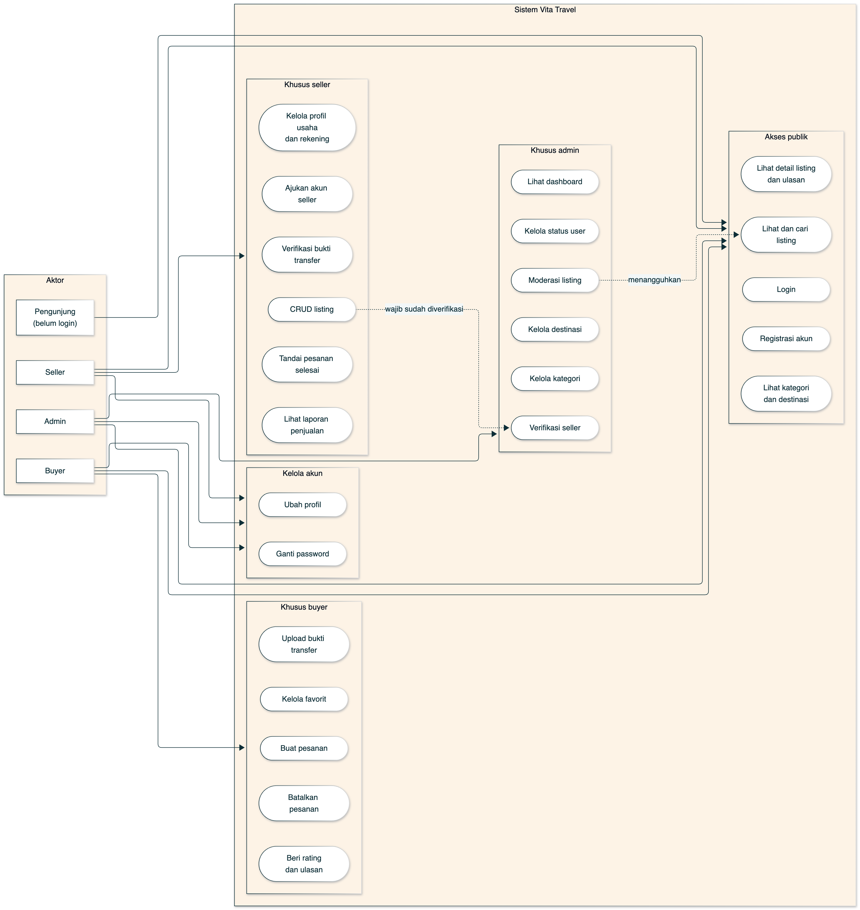

**Penjelasan interaksi aktor dengan sistem:**

| Aktor | Interaksi dengan Sistem |
| --- | --- |
| **Pengunjung** | Mengakses lima fungsi publik tanpa perlu login: melihat dan mencari listing, melihat detail listing beserta ulasan, melihat kategori dan destinasi, mendaftar akun, serta login. Fungsinya terbatas pada membaca dan membuat akun. |
| **Buyer** | Selain fungsi publik, buyer mengelola favorit, membuat pesanan, mengunggah bukti transfer, membatalkan pesanan, memberi rating dan ulasan, serta melihat daftar pesanannya sendiri. |
| **Seller** | Mengajukan akun seller, mengelola profil usaha dan rekening, menambah dan mengubah listing, memverifikasi bukti transfer, menandai pesanan selesai, melihat laporan penjualan, dan membatalkan pesanan. |
| **Admin** | Memverifikasi pengajuan seller, mengelola kategori dan destinasi, menangguhkan atau memulihkan listing, mengaktifkan atau menonaktifkan pengguna, dan melihat dashboard statistik. |

**Hubungan antar use case yang perlu diperhatikan:**

- Use case **CRUD listing** memiliki ketergantungan (*include*) pada use case **Verifikasi seller**:
  seller tidak dapat menambah listing sebelum pengajuannya disetujui admin.
- Use case **Moderasi listing** memengaruhi use case **Lihat dan cari listing**: listing yang
  ditangguhkan langsung hilang dari hasil pencarian publik.

### 4.1.2 Activity Diagram

Activity diagram memerinci alur proses di dalam sistem. Karena alur pemesanan cukup panjang, diagram
dipecah menjadi tiga bagian agar tetap terbaca.

**A. Diagram aktivitas pembuatan pesanan**

Menjelaskan alur dari buyer membuka detail listing sampai pesanan tersimpan. Terlihat dua jalur
penolakan: kuota habis dan masukan tidak valid.


**B. Diagram aktivitas pembayaran dan verifikasi**

Menjelaskan alur transfer manual, unggah bukti, dan keputusan seller. Penolakan bukti mengembalikan
alur ke tahap pembayaran.


**C. Diagram aktivitas penyelesaian pesanan**

Menjelaskan alur penandaan selesai oleh seller dan pemberian ulasan oleh buyer.


**D. Diagram aktivitas registrasi dan verifikasi seller**


### 4.1.3 Class Diagram

Class diagram berikut menggambarkan delapan kelas utama beserta atribut, metode, dan hubungannya.
Kelas-kelas ini mewakili tabel basis data sekaligus model data pada aplikasi mobile.

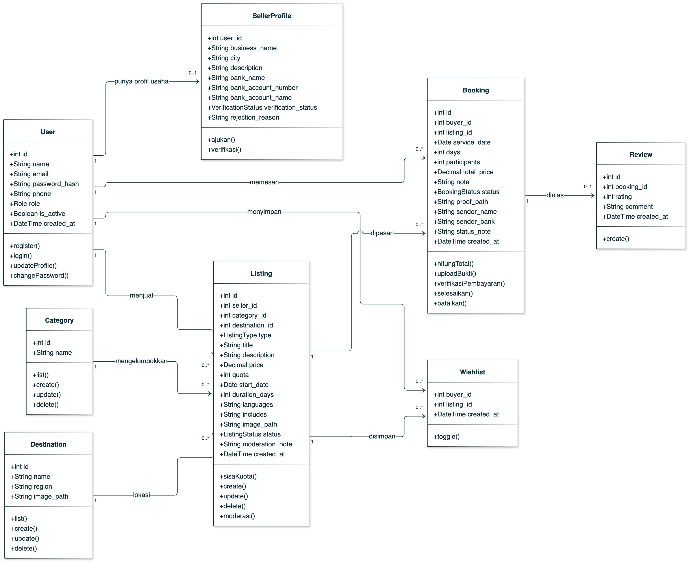

**Penjelasan hubungan antar kelas:**

| Hubungan | Jenis | Keterangan |
| --- | --- | --- |
| User → SellerProfile | 1 : 0..1 | Satu pengguna berperan seller memiliki paling banyak satu profil usaha. Profil ini menyimpan data rekening yang dipakai sebagai tujuan transfer. |
| User → Listing | 1 : 0..* | Satu seller menjual banyak listing. |
| User → Booking | 1 : 0..* | Satu buyer membuat banyak pesanan. |
| User → Wishlist | 1 : 0..* | Satu buyer menyimpan banyak listing favorit. |
| Category → Listing | 1 : 0..* | Satu kategori menampung banyak listing dan tidak dapat dihapus selama masih dipakai. |
| Destination → Listing | 1 : 0..* | Satu destinasi menjadi lokasi banyak listing dan tidak dapat dihapus selama masih dipakai. |
| Listing → Booking | 1 : 0..* | Satu listing dapat dipesan berkali-kali selama kuotanya mencukupi. |
| Listing → Wishlist | 1 : 0..* | Satu listing dapat disimpan banyak buyer. |
| Booking → Review | 1 : 0..1 | Satu pesanan memiliki paling banyak satu ulasan, dan ulasan hanya sah untuk pesanan yang sudah selesai. |

**Metode penting pada kelas Booking:**

| Metode | Tanggung Jawab |
| --- | --- |
| `hitungTotal()` | Menghitung total biaya: harga dikali jumlah peserta untuk trip, harga dikali jumlah hari untuk pemandu. |
| `uploadBukti()` | Menyimpan berkas bukti transfer dan mengubah status menjadi menunggu verifikasi. |
| `verifikasiPembayaran()` | Menyetujui atau menolak bukti transfer; penolakan mengembalikan status dan wajib disertai alasan. |
| `selesaikan()` | Mengubah status menjadi selesai, membuka kesempatan pemberian ulasan. |
| `batalkan()` | Membatalkan pesanan dengan alasan. |

### 4.1.4 Matriks Hak Akses

Matriks berikut memerinci akses setiap peran terhadap fungsi sistem. Penerapannya dilakukan dua kali:
di backend melalui middleware, dan di aplikasi melalui pembatasan tampilan.

| Fungsi | Pengunjung | Buyer | Seller | Admin |
| --- | :---: | :---: | :---: | :---: |
| Lihat dan cari listing | ✓ | ✓ | ✓ | ✓ |
| Lihat detail listing dan ulasan | ✓ | ✓ | ✓ | ✓ |
| Registrasi dan login | ✓ | — | — | — |
| Kelola favorit | | ✓ | | |
| Buat pesanan | | ✓ | | |
| Unggah bukti transfer | | ✓ | | |
| Beri rating dan ulasan | | ✓ | | |
| Lihat daftar pesanan sendiri | | ✓ | ✓ | ✓ |
| CRUD listing milik sendiri | | | ✓ | |
| Verifikasi bukti transfer | | | ✓ | |
| Tandai pesanan selesai | | | ✓ | |
| Lihat laporan penjualan | | | ✓ | |
| Verifikasi pengajuan seller | | | | ✓ |
| Kelola kategori dan destinasi | | | | ✓ |
| Moderasi listing | | | | ✓ |
| Kelola status pengguna | | | | ✓ |
| Lihat dashboard statistik | | | | ✓ |

## 4.2 Perancangan Database

### 4.2.1 Entity Relationship Diagram (ERD)

Basis data `vita_travel` terdiri atas delapan tabel yang saling berhubungan. Struktur ini dibuat oleh
berkas `backend/database/schema.sql`, sedangkan data contohnya diisi oleh
`backend/database/seed.js`.

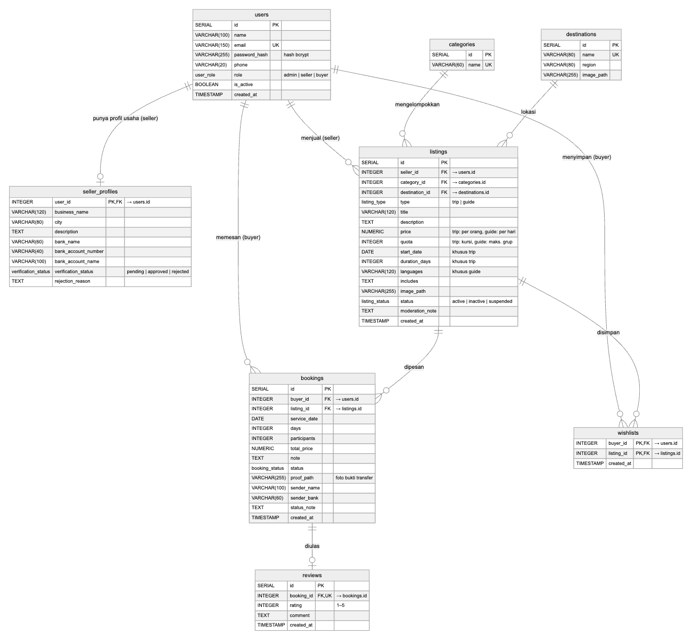

Hubungan antar tabel:

| Relasi | Kardinalitas | Keterangan |
| --- | --- | --- |
| `users` → `seller_profiles` | 1 : 0..1 | Profil usaha hanya dimiliki peran seller |
| `users` → `listings` | 1 : 0..* | Seller menjual banyak listing |
| `users` → `bookings` | 1 : 0..* | Buyer membuat banyak pesanan |
| `users` → `wishlists` | 1 : 0..* | Buyer menyimpan banyak favorit |
| `categories` → `listings` | 1 : 0..* | Kategori mengelompokkan listing |
| `destinations` → `listings` | 1 : 0..* | Destinasi menjadi lokasi listing |
| `listings` → `bookings` | 1 : 0..* | Listing dapat dipesan berkali-kali |
| `listings` → `wishlists` | 1 : 0..* | Listing dapat disimpan banyak buyer |
| `bookings` → `reviews` | 1 : 0..1 | Satu ulasan per pesanan |

### 4.2.2 Table Schema

#### A. Ringkasan Tabel

| No | Nama Tabel | Fungsi | Primary Key | Foreign Key |
| --- | --- | --- | --- | --- |
| 1 | `users` | Akun seluruh peran | `id` | — |
| 2 | `seller_profiles` | Data usaha dan rekening seller | `user_id` | `user_id` → `users.id` |
| 3 | `categories` | Kategori listing | `id` | — |
| 4 | `destinations` | Destinasi wisata beserta foto | `id` | — |
| 5 | `listings` | **Data utama 1**: paket trip dan jasa pemandu | `id` | `seller_id`, `category_id`, `destination_id` |
| 6 | `bookings` | **Data utama 2**: pesanan dan bukti transfer | `id` | `buyer_id`, `listing_id` |
| 7 | `reviews` | Rating dan ulasan buyer | `id` | `booking_id` |
| 8 | `wishlists` | Daftar favorit buyer | `buyer_id`, `listing_id` | `buyer_id`, `listing_id` |

Dua data utama yang saling berhubungan sebagaimana disyaratkan soal adalah **`listings`** yang dikelola
seller dan **`bookings`** yang dibuat buyer. Keduanya terhubung melalui `bookings.listing_id`.

#### B. Skema Rinci

**1. Tabel `users`**

```sql
CREATE TABLE users (
  id            SERIAL PRIMARY KEY,
  name          VARCHAR(100) NOT NULL,
  email         VARCHAR(150) NOT NULL UNIQUE,
  password_hash VARCHAR(255) NOT NULL,
  phone         VARCHAR(20),
  role          user_role    NOT NULL DEFAULT 'buyer',
  is_active     BOOLEAN      NOT NULL DEFAULT TRUE,
  created_at    TIMESTAMP    NOT NULL DEFAULT NOW()
);
```

**2. Tabel `seller_profiles`**

```sql
CREATE TABLE seller_profiles (
  user_id             INTEGER PRIMARY KEY REFERENCES users (id) ON DELETE CASCADE,
  business_name       VARCHAR(120) NOT NULL,
  city                VARCHAR(80)  NOT NULL,
  description         TEXT,
  bank_name           VARCHAR(60),
  bank_account_number VARCHAR(40),
  bank_account_name   VARCHAR(100),
  verification_status verification_status NOT NULL DEFAULT 'pending',
  rejection_reason    TEXT
);
```

**3. Tabel `categories`**

```sql
CREATE TABLE categories (
  id   SERIAL PRIMARY KEY,
  name VARCHAR(60) NOT NULL UNIQUE
);
```

**4. Tabel `destinations`**

```sql
CREATE TABLE destinations (
  id         SERIAL PRIMARY KEY,
  name       VARCHAR(80) NOT NULL UNIQUE,
  region     VARCHAR(80) NOT NULL,
  image_path VARCHAR(255)
);
```

**5. Tabel `listings`**

```sql
CREATE TABLE listings (
  id             SERIAL PRIMARY KEY,
  seller_id      INTEGER NOT NULL REFERENCES users (id) ON DELETE CASCADE,
  category_id    INTEGER NOT NULL REFERENCES categories (id) ON DELETE RESTRICT,
  destination_id INTEGER NOT NULL REFERENCES destinations (id) ON DELETE RESTRICT,
  type           listing_type   NOT NULL,
  title          VARCHAR(120)   NOT NULL,
  description    TEXT           NOT NULL,
  price          NUMERIC(12, 2) NOT NULL CHECK (price > 0),
  quota          INTEGER        NOT NULL CHECK (quota > 0),
  start_date     DATE,
  duration_days  INTEGER CHECK (duration_days > 0),
  languages      VARCHAR(120),
  includes       TEXT,
  image_path     VARCHAR(255),
  status         listing_status NOT NULL DEFAULT 'active',
  moderation_note TEXT,
  created_at     TIMESTAMP NOT NULL DEFAULT NOW(),
  CHECK (type = 'guide' OR (start_date IS NOT NULL AND duration_days IS NOT NULL))
);
```

**6. Tabel `bookings`**

```sql
CREATE TABLE bookings (
  id           SERIAL PRIMARY KEY,
  buyer_id     INTEGER NOT NULL REFERENCES users (id) ON DELETE CASCADE,
  listing_id   INTEGER NOT NULL REFERENCES listings (id) ON DELETE RESTRICT,
  service_date DATE    NOT NULL,
  days         INTEGER NOT NULL DEFAULT 1 CHECK (days > 0),
  participants INTEGER NOT NULL CHECK (participants > 0),
  total_price  NUMERIC(14, 2) NOT NULL CHECK (total_price > 0),
  note         TEXT,
  status       booking_status NOT NULL DEFAULT 'pending_payment',
  proof_path   VARCHAR(255),
  sender_name  VARCHAR(100),
  sender_bank  VARCHAR(60),
  status_note  TEXT,
  created_at   TIMESTAMP NOT NULL DEFAULT NOW()
);
```

**7. Tabel `reviews`**

```sql
CREATE TABLE reviews (
  id         SERIAL PRIMARY KEY,
  booking_id INTEGER NOT NULL UNIQUE REFERENCES bookings (id) ON DELETE CASCADE,
  rating     INTEGER NOT NULL CHECK (rating BETWEEN 1 AND 5),
  comment    TEXT,
  created_at TIMESTAMP NOT NULL DEFAULT NOW()
);
```

**8. Tabel `wishlists`**

```sql
CREATE TABLE wishlists (
  buyer_id   INTEGER NOT NULL REFERENCES users (id) ON DELETE CASCADE,
  listing_id INTEGER NOT NULL REFERENCES listings (id) ON DELETE CASCADE,
  created_at TIMESTAMP NOT NULL DEFAULT NOW(),
  PRIMARY KEY (buyer_id, listing_id)
);
```

#### C. Aturan Integritas Data

| Aturan | Penerapan | Alasan |
| --- | --- | --- |
| **ON DELETE RESTRICT** | `listings.category_id`, `listings.destination_id`, `bookings.listing_id` | Kategori atau destinasi yang masih dipakai listing tidak boleh terhapus, begitu pula listing yang sudah memiliki pesanan. Sistem membalas 409 bila hal ini dicoba. |
| **ON DELETE CASCADE** | `seller_profiles`, `reviews`, `wishlists` | Data turunan tidak bermakna tanpa induknya, sehingga ikut terhapus bersama induk. |
| **CHECK** | `price > 0`, `quota > 0`, `days > 0`, `participants > 0`, `rating BETWEEN 1 AND 5` | Mencegah masuknya nilai yang tidak masuk akal di tingkat basis data, bukan hanya di aplikasi. |
| **CHECK bersyarat** | `type = 'guide' OR (start_date IS NOT NULL AND duration_days IS NOT NULL)` | Paket trip wajib memiliki tanggal berangkat dan durasi; jasa pemandu tidak. |
| **ENUM** | `user_role`, `verification_status`, `listing_type`, `listing_status`, `booking_status` | Membatasi nilai pada daftar yang sah, sehingga salah ketik tidak dapat masuk. |
| **UNIQUE** | `users.email`, `categories.name`, `destinations.name`, `reviews.booking_id` | Mencegah duplikasi akun, kategori, destinasi, dan ulasan ganda. |
| **PRIMARY KEY majemuk** | `wishlists (buyer_id, listing_id)` | Satu buyer tidak dapat menyimpan listing yang sama dua kali. |

## 4.3 Struktur Project

### 4.3.1 Struktur Folder

```
PRELOVE/
├── backend/                     REST API (Node.js + Express + PostgreSQL)
│   ├── database/
│   │   ├── schema.sql           DDL: tabel, ENUM, PK, FK, CHECK
│   │   ├── seed.js              DML: akun uji dan data contoh
│   │   ├── setup.js             npm run db:setup (buat database, schema, seed)
│   │   └── seed-images/         Foto contoh untuk data awal
│   ├── certs/
│   │   ├── aiven-ca.pem         Sertifikat CA proyek Aiven untuk verifikasi SSL
│   │   └── README.md            Cara mengunduh dan memasang CA tersebut
│   ├── src/
│   │   ├── server.js            Menjalankan server
│   │   ├── app.js               Daftar middleware dan route
│   │   ├── config.js            Membaca konfigurasi dari .env
│   │   ├── db.js                Koneksi PostgreSQL dan helper transaksi
│   │   ├── validators.js        Aturan validasi masukan (zod)
│   │   ├── controllers/         Logika dan query SQL tiap fitur (8 berkas)
│   │   ├── middleware/          auth, upload, validate, errorHandler
│   │   ├── routes/              Peta URL ke controller (8 berkas)
│   │   └── utils/               Helper balasan dan penyusun query listing
│   └── tests/api.test.js        Uji otomatis REST API (22 kasus)
├── mobile/                      Aplikasi mobile (Flutter)
│   ├── lib/
│   │   ├── main.dart            Titik awal aplikasi, provider, tema
│   │   ├── config.dart          Alamat REST API
│   │   ├── models/              Kelas data dan fromJson
│   │   ├── services/            Pemanggil endpoint API
│   │   ├── providers/           Keadaan global: sesi login dan favorit
│   │   ├── screens/             Halaman per peran: auth, buyer, seller, admin, shared
│   │   ├── theme/app_theme.dart Design system: warna, tipografi, spasi, radius
│   │   ├── utils/               Validator dan pemformatan Rupiah serta tanggal
│   │   └── widgets/             Komponen yang dipakai berulang (11 berkas)
│   └── test/app_test.dart       Uji widget dan logika (10 kasus)
├── src/                         Website company profile (Vite + React)
│   ├── components/              Header, footer, kartu listing, carousel, tombol
│   ├── pages/                   Halaman home dan halaman paket perjalanan
│   ├── animations/              Animasi GSAP
│   ├── router.jsx               Peta alamat ke halaman
│   └── styles/                  CSS: tema, tipografi, dan gaya komponen
├── public/                      Gambar, ikon, dan font website
├── legacy/                      Ekspor Webflow asli, disimpan sebagai rujukan desain
│   ├── html/, css/, js/         Halaman, gaya, dan skrip hasil ekspor
│   └── assets/                  Gambar, ikon, dan font hasil ekspor
├── docs/
│   ├── SRS.md                   Dokumen ini
│   ├── SRS_Vita_Travel.docx     Dokumen ini dalam format Word
│   ├── API.md                   Daftar lengkap endpoint
│   ├── ERD.md                   Penjelasan basis data
│   ├── ALUR.md                  Alur kerja dan struktur kode
│   ├── erd.svg, erd.png         Gambar ERD
│   ├── diagrams/                Sumber Mermaid (.mmd) dan gambar (.png) semua diagram
│   ├── screenshots/             Tangkapan layar aplikasi dan website untuk lampiran
│   ├── tools/md_to_docx.py      Membangkitkan DOCX dari SRS.md
│   └── vita-travel.postman_collection.json
├── README.md                    Cara menjalankan dan akun uji
├── .gitignore                   Berkas yang tidak ikut ke repositori
└── SOAL_AAS_KOKE_XI_RPL_2026_2027.docx
```

### 4.3.2 Ukuran Proyek

| Bagian | Berkas | Baris Kode | Keterangan |
| --- | --- | --- | --- |
| Backend (`backend/src`) | 27 | ± 1.700 | 8 controller, 8 route, 4 middleware |
| Aplikasi mobile (`mobile/lib`) | 56 | ± 7.700 | 26 halaman, 11 komponen, 6 layanan |
| Website (`src`) | 61 | ± 15.000 | 61 berkas komponen, halaman, dan gaya |
| Basis data | 3 | ± 700 | 1 skema DDL dan 2 berkas data |
| Pengujian | 2 | ± 520 | 22 uji API dan 10 uji mobile |
| **Total kode program** | **149** | **± 25.600** | Belum termasuk berkas pendukung |

### 4.3.3 Penjelasan Struktur

**Pemisahan tanggung jawab pada backend.** Setiap permintaan melewati rantai yang jelas: `routes`
menentukan alamat dan middleware yang berlaku, `middleware` memeriksa keamanan dan keabsahan masukan,
`controllers` menjalankan aturan bisnis dan query, dan `utils` menyusun balasan dengan bentuk yang
seragam. Pemisahan ini membuat aturan seperti "hanya seller terverifikasi yang boleh menambah listing"
cukup ditulis sekali sebagai middleware, bukan diulang di setiap pengendali.

**Pengelompokan halaman menurut peran pada mobile.** Folder `screens/` dibagi menjadi `auth`, `buyer`,
`seller`, `admin`, dan `shared`. Pembagian ini memudahkan pencarian: halaman yang hanya dipakai satu
peran tidak bercampur dengan halaman yang dipakai bersama.

**Pemisahan data dari tampilan pada website.** Isi paket perjalanan disimpan pada `src/data/` sebagai
data terstruktur, sedangkan halaman hanya bertugas menampilkannya. Menambah atau mengubah paket tidak
memerlukan perubahan pada berkas halaman.

**Penamaan berkas yang menggambarkan isi.** Seluruh berkas diberi nama menurut fungsinya, misalnya
`booking.controller.js`, `listing_detail_screen.dart`, dan `retreat-card.jsx`. Tidak ada berkas yang
dinamai berdasarkan kode acak atau tanggal pembuatan.

**Folder `legacy/` disimpan sebagai rujukan, bukan bagian sistem yang berjalan.** Isinya adalah
ekspor mentah situs Webflow yang menjadi acuan desain website. Folder ini tidak dipakai saat build
maupun saat API berjalan, dan sengaja tidak diformat ulang agar tampilan aslinya tetap dapat
dibandingkan bila ada perbedaan desain yang perlu ditelusuri.

**Berkas yang tidak ikut ke repositori diatur pada `.gitignore`.** Yang dikecualikan adalah berkas
rahasia (`.env` berisi alamat basis data dan kunci token), folder dependensi (`node_modules`), hasil
build (`dist`, `build`), serta folder unggahan pengguna. Yang tetap ikut adalah `backend/.env.example`
sebagai contoh tanpa nilai rahasia, sehingga penguji dapat menyiapkan sendiri berkas `.env` miliknya.

## 4.4 Quality Assurance (Blackbox Testing)

### 4.4.1 Pendekatan Pengujian

Pengujian dilakukan dalam tiga lapis yang saling melengkapi, bukan saling menggantikan.

| Lapis | Alat | Jumlah Kasus | Sasaran |
| --- | --- | --- | --- |
| Uji otomatis API | `node --test` + supertest | 22 | Aturan bisnis dan kode status pada tingkat kode |
| Uji otomatis mobile | `flutter test` | 10 | Validator, pemformatan, pengalihan peran, dialog konfirmasi |
| Uji blackbox manual | Skrip HTTP terhadap server hidup | 42 | Perilaku sistem nyata dari luar, memakai database dan folder unggahan yang sama seperti saat dipakai pengguna |

Perbedaan lapis pertama dan ketiga penting: uji otomatis memanggil aplikasi secara langsung di dalam
proses yang sama, sedangkan uji blackbox benar-benar mengirim permintaan HTTP ke server yang sedang
berjalan. Lapis ketiga inilah yang membuktikan sistem bekerja pada kondisi pemakaian sesungguhnya.

Pengujian blackbox memperlakukan sistem sebagai kotak hitam: yang diperiksa adalah kesesuaian antara
masukan yang diberikan dan balasan yang diterima (kode status serta isi pesan), bukan cara kerja
internalnya.

### 4.4.2 Hasil Uji Blackbox

Pengujian dijalankan terhadap API yang hidup pada `http://127.0.0.1:3001/api`. Setiap kasus mencatat
kode status yang diharapkan dan kode status yang benar-benar diterima.

Pengujian ini dijalankan dua kali: sekali ketika basis data masih berada di komputer pengembangan, dan
sekali lagi setelah basis data dipindahkan ke Aiven (Bab IV.5.3). Keduanya menghasilkan hasil yang
sama, 42 dari 42 kasus sesuai harapan.

**Rekapitulasi: 42 kasus dijalankan, 42 sesuai harapan, 0 tidak sesuai.**

| Kode | Hasil |
| --- | --- |
| Total kasus uji | 42 |
| Lulus | 42 |
| Gagal | 0 |
| Persentase keberhasilan | 100% |

#### A. Pengujian Autentikasi dan Otorisasi (10 kasus)

| No | Skenario Uji | Diharapkan | Diperoleh | Hasil |
| --- | --- | --- | --- | --- |
| 1 | Mengakses root API untuk memastikan server hidup | 200 | 200 | Sesuai |
| 2 | Mendaftar akun buyer baru dengan data lengkap dan sah | 201 | 201 | Sesuai |
| 3 | Mendaftar dengan email yang sudah terdaftar | 409 | 409 | Sesuai |
| 4 | Mendaftar dengan format email tidak valid | 400 | 400 | Sesuai |
| 5 | Login dengan email dan password benar | 200 | 200 | Sesuai |
| 6 | Login dengan password salah | 401 | 401 | Sesuai |
| 7 | Mengambil profil tanpa menyertakan token | 401 | 401 | Sesuai |
| 8 | Mengambil profil dengan token sah | 200 | 200 | Sesuai |
| 9 | Buyer mencoba mengakses endpoint khusus admin | 403 | 403 | Sesuai |
| 10 | Admin mengakses dashboard yang menjadi haknya | 200 | 200 | Sesuai |

#### B. Pengujian Listing dan Unggah Gambar (12 kasus)

| No | Skenario Uji | Diharapkan | Diperoleh | Hasil |
| --- | --- | --- | --- | --- |
| 11 | Menampilkan daftar listing publik | 200 | 200 | Sesuai |
| 12 | Mencari listing dengan kata kunci | 200 | 200 | Sesuai |
| 13 | Menyaring listing berdasarkan jenis pemandu | 200 | 200 | Sesuai |
| 14 | Membuka detail listing yang tidak ada | 404 | 404 | Sesuai |
| 15 | Buyer mencoba menambah listing | 403 | 403 | Sesuai |
| 16 | Menambah listing tanpa menyertakan foto | 400 | 400 | Sesuai |
| 17 | Mengunggah berkas bukan gambar (berkas teks) | 415 | 415 | Sesuai |
| 18 | Mengunggah gambar berukuran 2,5 MB | 413 | 413 | Sesuai |
| 19 | Menambah listing lengkap dengan foto | 201 | 201 | Sesuai |
| 20 | Mengakses kembali gambar hasil unggahan | 200 | 200 | Sesuai |
| 21 | Seller lain mencoba mengubah listing milik seller pertama | 403 | 403 | Sesuai |
| 22 | Seller mengubah listingnya sendiri tanpa mengganti foto | 200 | 200 | Sesuai |

#### C. Pengujian Alur Pesanan (11 kasus)

| No | Skenario Uji | Diharapkan | Diperoleh | Hasil |
| --- | --- | --- | --- | --- |
| 23 | Memesan dengan jumlah peserta melebihi kuota | 409 | 409 | Sesuai |
| 24 | Membuat pesanan dengan data sah | 201 | 201 | Sesuai |
| 25 | Mengunggah bukti transfer tanpa mengisi nama pengirim | 400 | 400 | Sesuai |
| 26 | Mengunggah bukti transfer lengkap | 200 | 200 | Sesuai |
| 27 | Seller menolak bukti transfer tanpa memberi alasan | 400 | 400 | Sesuai |
| 28 | Seller menyetujui bukti transfer | 200 | 200 | Sesuai |
| 29 | Buyer mengulas pesanan yang belum selesai | 409 | 409 | Sesuai |
| 30 | Seller menandai pesanan sebagai selesai | 200 | 200 | Sesuai |
| 31 | Buyer memberi rating dan ulasan pada pesanan selesai | 201 | 201 | Sesuai |
| 32 | Buyer mengulas pesanan yang sama untuk kedua kali | 409 | 409 | Sesuai |
| 33 | Menghapus listing yang sudah memiliki pesanan | 409 | 409 | Sesuai |

#### D. Pengujian Data Master dan Admin (9 kasus)

| No | Skenario Uji | Diharapkan | Diperoleh | Hasil |
| --- | --- | --- | --- | --- |
| 34 | Menampilkan daftar kategori | 200 | 200 | Sesuai |
| 35 | Menampilkan daftar destinasi | 200 | 200 | Sesuai |
| 36 | Admin menambah kategori baru | 201 | 201 | Sesuai |
| 37 | Admin menambah kategori dengan nama yang sudah ada | 409 | 409 | Sesuai |
| 38 | Admin menghapus kategori yang masih dipakai listing | 409 | 409 | Sesuai |
| 39 | Seller melihat laporan penjualannya | 200 | 200 | Sesuai |
| 40 | Buyer melihat daftar favoritnya | 200 | 200 | Sesuai |
| 41 | Seller mencoba mengakses fitur favorit milik buyer | 403 | 403 | Sesuai |
| 42 | Admin melihat daftar seller yang menunggu verifikasi | 200 | 200 | Sesuai |

### 4.4.3 Hasil Uji Otomatis

**A. Uji REST API (22 kasus)**

Dijalankan dengan perintah `npm test` pada folder `backend`. Seluruh 22 kasus lulus dalam waktu
sekitar 2,1 detik.

| Kelompok Uji | Jumlah | Hasil |
| --- | --- | --- |
| Autentikasi (hash password, email duplikat, validasi, login salah) | 4 | Lulus semua |
| Otorisasi peran (tanpa token, peran salah, seller belum diverifikasi, data milik orang lain) | 4 | Lulus semua |
| Unggah gambar dan CRUD listing (tipe berkas, ukuran, foto wajib, kepemilikan, alur pesanan) | 8 | Lulus semua |
| Aturan bisnis lain (jadwal bentrok, kategori terpakai, verifikasi seller, moderasi, akun nonaktif) | 6 | Lulus semua |

Kasus yang paling membuktikan bekerjanya sistem adalah **alur pesanan lengkap**: pesan → bayar →
verifikasi → selesai → ulasan, yang dijalankan sebagai satu rangkaian dan memeriksa status pesanan di
setiap langkahnya.

**B. Uji Aplikasi Mobile (10 kasus)**

Dijalankan dengan perintah `flutter test` pada folder `mobile`. Seluruh 10 kasus lulus.

| Kelompok Uji | Jumlah | Hasil |
| --- | --- | --- |
| Validator (email, password, nomor HP, angka berbatas) | 4 | Lulus semua |
| Pemformatan (Rupiah, tanggal Indonesia, label status pesanan) | 3 | Lulus semua |
| Pengalihan halaman sesuai peran | 1 | Lulus semua |
| Tampilan pesan validasi pada form login | 1 | Lulus semua |
| Dialog konfirmasi penghapusan | 1 | Lulus semua |

### 4.4.4 Pengujian yang Belum Dijalankan

Sesuai prinsip keterbukaan dokumen ini, hal-hal berikut **belum diuji** dan karenanya belum dapat
dinyatakan memenuhi syarat:

| No | Pengujian | Alasan Belum Dijalankan |
| --- | --- | --- |
| 1 | Uji beban dengan jumlah pengguna bersamaan yang besar | Jumlah pengguna sistem masih terbatas; uji beban memerlukan perkakas dan lingkungan terpisah. |
| 2 | Uji keamanan oleh pihak ketiga | Diluar cakupan waktu dan kewenangan proyek. |
| 3 | Uji pada perangkat iOS | Belum tersedia perangkat uji berplatform iOS. |
| 4 | Uji kompatibilitas pada Firefox dan Safari | Pengujian baru dilakukan pada peramban berbasis Chromium. |
| 5 | Uji pemulihan setelah basis data mati mendadak | Belum disimulasikan. |

## 4.5 Deployment

### 4.5.1 Status Deployment

Penyebaran dikerjakan bertahap, sehingga keadaannya per tanggal dokumen ini tidak sama untuk setiap
komponen.

| Komponen | Status | Keterangan |
| --- | --- | --- |
| Repositori Git | **Selesai** | `https://github.com/fahrizaza/Vita-Travel`, bercabang menurut modul, rincian pada Bab IV.5.7 |
| Basis data PostgreSQL | **Selesai** | Berjalan di Aiven, sudah diuji sambungan dan isinya, rincian pada Bab IV.5.3 |
| Website company profile | **Selesai** | Berjalan di `https://vita-travel.netlify.app`, sudah diuji seluruh halamannya, rincian pada Bab IV.5.5 |
| REST API | Belum | Masih berjalan di komputer pengembangan (`http://localhost:3001/api`) |
| Aplikasi mobile | Belum | APK belum dibangun dengan alamat API daring |

Karena itu, subbab 4.5.4 dan 4.5.6 masih berisi **rancangan langkah penyebaran**, sedangkan subbab
4.5.3 dan 4.5.5 sudah berisi **hasil yang benar-benar dikerjakan** beserta bukti pengujiannya. Subbab
yang masih berisi rancangan akan diperbarui dengan cara yang sama setelah dikerjakan.

Pembagian ini sesuai ketentuan soal, yang menyebut dua penyebaran secara khusus: **website ke
Vercel/Netlify** dan **basis data ke Aiven**. Keduanya sudah selesai. Penyebaran REST API dan aplikasi
mobile dikerjakan sebagai kelanjutan, bukan sebagai syarat soal.

### 4.5.2 Rancangan Arsitektur Deployment

| Komponen | Layanan yang Direncanakan | Layanan yang Dipakai | Alasan Pemilihan |
| --- | --- | --- | --- |
| Website company profile | Vercel atau Netlify | **Netlify** | Keduanya menangani aplikasi statis hasil build Vite secara otomatis, menyediakan HTTPS, dan terhubung langsung ke repositori Git. Netlify dipilih karena perkakas baris perintahnya sudah tersedia dan sudah tertaut pada akun yang dipakai. |
| Basis data PostgreSQL | Aiven | **Aiven** | Menyediakan PostgreSQL terkelola dengan pencadangan otomatis, dapat diakses dari luar jaringan lokal. |
| REST API | Vercel (serverless) atau Render | *belum* | Menjalankan aplikasi Node.js tanpa mengelola server sendiri. |
| Aplikasi mobile | Build APK atau Flutter web | *belum* | Dibagikan langsung atau di-host sebagai aplikasi web. |

Baris website dan basis data pada tabel di atas sudah terwujud; dua baris lainnya masih berupa rencana.

### 4.5.3 Penyebaran Basis Data ke Aiven (Sudah Dikerjakan)

Basis data sudah berjalan di **Aiven for PostgreSQL**, bukan lagi di komputer pengembangan.

**A. Data layanan**

| Item | Nilai |
| --- | --- |
| Penyedia | Aiven for PostgreSQL |
| Host | `pg-23410fb1-ghiffary-a1c7.a.aivencloud.com` |
| Port | `10504` |
| Nama database | `vita_travel` |
| Database bawaan | `defaultdb`, dipakai hanya saat membuat database baru |
| Pengguna | `avnadmin` |
| Versi server | PostgreSQL 18.7 |
| Batas sambungan | 20 koneksi |
| Kata sandi | Tersimpan pada `backend/.env`, **tidak ditulis** di dokumen ini maupun di repositori |

**B. Langkah yang dikerjakan**

1. Membuat layanan PostgreSQL pada Aiven, lalu menyalin **Service URI** beserta sertifikat CA-nya.
2. Menyimpan URI tersebut sebagai `DATABASE_URL` pada `backend/.env`. Berkas ini dikecualikan oleh
   `.gitignore`, sehingga kata sandi tidak ikut ke repositori.
3. Menyimpan sertifikat CA sebagai `backend/certs/aiven-ca.pem`, lalu meneruskannya ke driver `pg`
   sebagai `ssl.ca` supaya identitas server benar-benar diverifikasi.
4. Menjalankan `npm run db:setup` dengan `DATABASE_URL` diarahkan ke Aiven. Perintah itu membuat
   database `vita_travel`, menjalankan `backend/database/schema.sql` (8 tabel dan 5 tipe ENUM), lalu
   mengisi data contoh. Skripnya mencoba database pemeliharaan `postgres` lebih dulu, lalu `defaultdb`,
   karena Aiven tidak menyediakan database bernama `postgres`.
5. Memastikan `TEST_DATABASE_URL` tetap menunjuk PostgreSQL lokal, sehingga `npm test` tidak pernah
   menghapus isi basis data daring.

**C. Kendala yang ditemukan dan penyelesaiannya**

Driver `pg` menolak sambungan ke Aiven dengan pesan `self-signed certificate in certificate chain`.
Penyebabnya bukan sertifikat yang salah, melainkan parameter `sslmode=require` yang ikut tersalin pada
Service URI: pada `pg-connection-string` versi 2, parameter itu **menimpa** pengaturan `ssl` yang
diberikan aplikasi, sehingga sertifikat CA yang sudah dipegang justru hilang tanpa peringatan.
Penyelesaiannya, parameter `sslmode` dibuang dari URI di `backend/src/config.js`, dan pengaturan SSL
sepenuhnya berasal dari sertifikat CA yang dibaca aplikasi.

Perbedaan itu dibuktikan dengan percobaan memakai kata sandi yang sengaja salah. URI **dengan**
`sslmode=require` berhenti pada tahap TLS, sedangkan URI **tanpa** parameter tersebut melewati TLS lalu
berhenti pada tahap autentikasi (kode `28P01`). Artinya pada percobaan kedua sertifikat sudah
terverifikasi dan yang tersisa hanyalah kata sandi.

**D. Bukti sambungan dan isi basis data**

| Pemeriksaan | Hasil |
| --- | --- |
| Verifikasi sertifikat | Lolos penuh terhadap CA proyek Aiven (TLSv1.3, TLS_AES_256_GCM_SHA384) |
| Alamat server yang menjawab | `159.223.237.210`, bukan `localhost` |
| Tabel | 8 tabel, sesuai rancangan |
| Tipe ENUM | 5 tipe, sesuai rancangan |
| Akun uji | 6 akun, seluruhnya berhasil login melalui REST API |
| Data contoh | 4 kategori, 5 destinasi, 12 listing, 10 pesanan, 4 ulasan, 2 favorit |
| Uji blackbox terhadap API yang menunjuk Aiven | 42 dari 42 kasus lulus |
| Uji otomatis `npm test` | 22 dari 22 lulus, tetap memakai basis data lokal |

Kemampuan menulis diuji secara terpisah dan sengaja tidak lewat API yang sedang diuji: sebuah kategori
dibuat melalui REST API, baris itu dibaca kembali melalui sambungan langsung ke server Aiven, lalu
dihapus lagi. Setelah seluruh pengujian, data contoh dikembalikan ke keadaan awal dengan menjalankan
`npm run db:setup` sekali lagi, dan sisa data uji dipastikan nol.

### 4.5.4 Langkah Deploy REST API

1. Menginisialisasi repositori Git pada folder proyek dan mengunggahnya ke GitHub.
2. Membuat akun pada Vercel atau Render, lalu menghubungkan repositori tersebut.
3. Menentukan folder **root** penyebaran sebagai `backend`.
4. Menambahkan variabel lingkungan berikut pada pengaturan layanan:
   - `DATABASE_URL` — URI Aiven dari langkah sebelumnya
   - `JWT_SECRET` — string acak panjang, dibuat dengan `openssl rand -hex 32`
   - `JWT_EXPIRES_IN` — nilai `7d`
   - `PORT` — menyesuaikan ketentuan layanan
5. Menjalankan proses build dan mencatat alamat API yang diberikan layanan.
6. Menguji endpoint `GET /api` untuk memastikan server berjalan dan basis data terhubung.

Catatan penting: berkas gambar yang diunggah disimpan pada sistem berkas server. Pada layanan
serverless, sistem berkas bersifat sementara sehingga berkas dapat hilang setiap proses dimulai ulang.
Untuk sistem yang berjalan sesungguhnya, folder unggahan perlu dipindahkan ke layanan penyimpanan objek.

### 4.5.5 Penyebaran Website ke Netlify (Sudah Dikerjakan)

Website company profile sudah berjalan di **`https://vita-travel.netlify.app`** dan dapat dibuka
siapa saja tanpa menjalankan apa pun di komputer pengembangan.

**A. Berkas konfigurasi penyebaran**

| Berkas | Isi | Alasan |
| --- | --- | --- |
| `netlify.toml` | Perintah `npm run build`, folder terbit `dist`, aturan pengalihan, aturan cache | Dibaca Netlify saat membangun dan menyajikan situs |
| `public/_redirects` | `/*  /index.html  200` | Disalin Vite ke `dist/`, sehingga aturan pengalihan tetap ikut meski penyebaran dijalankan dari akar yang berbeda |

**B. Langkah yang dikerjakan**

1. Membangun situs lebih dulu di komputer (`npm run build`) untuk memastikan tidak ada galat sebelum
   dikirim, lalu memastikan folder `dist/` berisi 170 berkas termasuk `index.html`.
2. Membuat proyek Netlify bernama `vita-travel` pada akun yang sudah tertaut, sehingga alamatnya
   menjadi `https://vita-travel.netlify.app`.
3. Menjalankan `netlify deploy --prod --dir=dist`. Netlify mengunggah 144 berkas dan melaporkan
   penyebaran berhasil.
4. Memeriksa hasilnya dari luar: seluruh alamat halaman dibuka satu per satu, lalu isi setiap halaman
   diukur di peramban — bukan sekadar melihat kode balasan.

**C. Kendala yang diantisipasi: halaman 404 saat alamat dibuka langsung**

Aplikasi web ini memakai React Router, yang memindahkan halaman **di sisi peramban**. Alamat seperti
`/retreat` atau `/bali` karena itu tidak punya berkasnya sendiri di folder hasil build — yang ada hanya
`index.html`. Bila tidak diatur, membuka alamat tersebut secara langsung (atau menyegarkan halaman pada
alamat itu) akan dijawab 404 oleh server, padahal halamannya jelas ada di dalam aplikasi.

Penyelesaiannya, seluruh alamat diarahkan ke `index.html` dengan kode **200**, bukan 301. Pilihan kode
status itu disengaja: kode 301 akan mengubah alamat yang terlihat di bilah peramban, sehingga pengunjung
yang membuka `/retreat` malah berpindah ke alamat akar dan halaman yang ingin dibagikan kehilangan
alamatnya.

**D. Bukti penyebaran**

| Pemeriksaan | Hasil |
| --- | --- |
| Alamat produksi | `https://vita-travel.netlify.app` (HTTPS, dilayani Netlify) |
| Halaman utama | 200 |
| Seluruh 10 alamat halaman | 200, termasuk `/retreat`, `/bali`, `/morocco`, `/coaches`, `/contacts` |
| Alamat yang tidak ada | 200, lalu menampilkan halaman "Page not found" buatan aplikasi — bukan halaman galat bawaan server |
| Aset (favicon, gambar, JS, CSS) | Seluruhnya termuat, tidak ada yang gagal |
| Isi halaman diukur di peramban | 524 elemen dan 4.852 huruf pada `/retreat`; 505 elemen pada `/bali` |
| Gambar | 24 gambar pada `/retreat` dan 23 pada `/bali`, tidak ada yang rusak |
| Galat JavaScript | Tidak ada |

Pengukuran isi halaman itu penting dan disengaja: berkas JavaScript yang menerima kode 200 tetap dapat
gagal dijalankan di peramban, dan kegagalan seperti itu hanya terlihat sebagai halaman kosong — bukan
sebagai kode galat apa pun. Karena itu halaman tidak hanya diambil kode balasannya, melainkan benar-benar
dibuka di peramban lalu diukur banyak elemen, panjang teks, tinggi halaman, jumlah gambar, dan galat
konsolnya.

### 4.5.6 Langkah Deploy Aplikasi Mobile

1. Menentukan alamat API daring saat membangun aplikasi:
   `flutter build apk --dart-define=API_URL=https://ALAMAT-API/api`
2. Berkas APK dihasilkan pada folder `mobile/build/app/outputs/flutter-apk/` dan dibagikan kepada
   penguji untuk dipasang pada perangkat Android.
3. Sebagai alternatif, aplikasi dapat dibangun untuk web dengan `flutter build web`, lalu di-host
   sebagai situs statis.

### 4.5.7 Pengelolaan Versi dengan Git

Sesuai ketentuan soal, perubahan kode dikelola melalui repositori Git dengan pencabangan. Repositori
proyek: **`https://github.com/fahrizaza/Vita-Travel`** (publik).

**A. Struktur cabang yang dipakai**

| Cabang | Fungsi | Isi |
| --- | --- | --- |
| `main` | Versi stabil dan siap diserahkan | Seluruh sistem, ditandai penanda versi `v1.0.0` |
| `develop` | Penggabungan seluruh fitur sebelum masuk `main` | Seluruh sistem, titik lanjut pengerjaan berikutnya |
| `feature/website-profil` | Pengerjaan website company profile | `src/`, `public/`, `legacy/`, berkas Vite |
| `feature/backend-api` | Pengerjaan REST API dan basis data | `backend/` |
| `feature/mobile-app` | Pengerjaan aplikasi Flutter | `mobile/` |
| `feature/dokumentasi` | Pengerjaan dokumen SRS dan diagram | `docs/` |
| `feature/database-aiven` | Penyambungan aplikasi ke basis data daring | `backend/src/config.js`, `backend/src/db.js`, `backend/certs/` |
| `fix/*` | Perbaikan yang ditemukan setelah pengujian | Berkas yang diperbaiki saja |

**B. Alur kerja yang dijalankan**

1. `main` dimulai dengan kerangka repositori: `.gitignore`, aturan Prettier dan oxlint, serta `README`.
2. Cabang `develop` dibuat dari `main` sebagai titik penggabungan.
3. Setiap modul dikerjakan pada cabang fiturnya sendiri, lalu digabungkan ke `develop` dengan
   *merge commit* agar riwayat pengerjaan tiap modul tetap terbaca.
4. Setelah seluruh modul selesai, `develop` digabungkan ke `main` dan diberi penanda versi.
5. Perbaikan yang muncul kemudian dikerjakan pada cabang `fix/*`, digabungkan ke `develop`, lalu naik
   ke `main` sebagai versi berikutnya.

Penanda versi yang sudah dibuat:

| Penanda | Isi |
| --- | --- |
| `v1.0.0` | Sistem lengkap: website, REST API, aplikasi mobile, dan basis data |
| `v1.1.0` | Perbaikan dokumen SRS setelah repositori Git dibuat |
| `v1.2.0` | Dukungan basis data Aiven dan dokumen yang diselaraskan dengannya |

Perintah yang dipakai:

```bash
git checkout -b feature/backend-api develop    # mulai cabang fitur
git checkout develop && git merge --no-ff feature/backend-api
git tag -a v1.0.0 -m "Vita Travel v1.0.0"      # tandai versi rilis
git push origin --all && git push origin --tags
```

Penggabungan memakai `--no-ff` (bukan *fast-forward*) dengan alasan: riwayat menjadi bercabang
sehingga terlihat jelas modul mana yang dikerjakan pada cabang mana. Tanpa opsi itu, riwayat akan
tampak berurutan seolah seluruh pekerjaan dilakukan sekaligus di satu cabang, dan pertanyaan seperti
"perubahan ini masuk lewat fitur apa" tidak lagi dapat dijawab dari riwayat.

**C. Berkas yang tidak ikut ke repositori**

| Dikecualikan | Alasan |
| --- | --- |
| `.env`, `.env.*` | Memuat alamat basis data dan kunci token yang bersifat rahasia |
| `node_modules/` | Dependensi dapat dipasang ulang dengan `npm install` |
| `dist/`, `build/` | Hasil build, dapat dibangun ulang dan ukurannya besar |
| `uploads/`, `uploads-test/` | Berkas unggahan pengguna, bukan bagian kode |
| `.DS_Store`, `.idea/`, `.vscode/*` | Berkas sistem operasi dan editor |
| `.vibecode/`, `.impeccable/` | Cache perkakas lokal |

Yang **tetap** ikut meski berkaitan dengan rahasia adalah `backend/.env.example`: berkas itu hanya
memuat nama variabel beserta contoh nilainya, tanpa nilai sebenarnya, sehingga penguji dapat
menyiapkan `.env` miliknya sendiri.

---

# BAB V PENUTUP

## 5.1 Kesimpulan

**A. Sistem yang Dirancang**

Dokumen ini merancang **Vita Travel**, sebuah marketplace jasa travel yang menghubungkan pelaku UMKM
jasa perjalanan — agen trip skala kecil dan pemandu wisata lokal — dengan pelanggannya. Sistem
menyelesaikan lima masalah pokok pelaku usaha tersebut: katalog yang tersebar, pesanan yang tidak
tercatat, pembayaran yang sulit dilacak, ketiadaan rekam jejak kualitas, dan ketiadaan laporan
performa.

**B. Perancangan yang Dihasilkan**

| Bagian | Hasil Perancangan |
| --- | --- |
| Basis data | 8 tabel dengan 5 tipe ENUM, dilengkapi Primary Key, Foreign Key, CHECK, dan aturan ON DELETE yang menjaga integritas data |
| REST API | 39 endpoint yang tersebar pada 8 kelompok fungsional, dengan bentuk balasan seragam dan penggunaan kode status HTTP yang sesuai |
| Autentikasi dan otorisasi | Token JWT dengan tiga peran pengguna, diperiksa berlapis melalui middleware |
| Aplikasi mobile | 26 halaman untuk tiga peran, dengan pembatasan tampilan sesuai hak akses |
| Website | 11 halaman company profile berbasis React |
| Data utama | `listings` (dikelola seller) dan `bookings` (dibuat buyer), dua data yang saling berhubungan sebagaimana disyaratkan |
| Diagram | Use case, 4 activity diagram, class diagram, ERD, diagram status pesanan, dan diagram jadwal |

**C. Hasil Pengujian**

Seluruh pengujian yang dijalankan menunjukkan hasil sesuai harapan: **22 dari 22** uji otomatis API
lulus dalam 2,1 detik, **10 dari 10** uji aplikasi mobile lulus, dan **42 dari 42** kasus uji blackbox
melalui HTTP menghasilkan kode status yang diharapkan. Perlu ditegaskan bahwa 42 kasus blackbox tersebut
dijalankan terhadap server yang benar-benar hidup, bukan terhadap pemanggilan fungsi di dalam kode.
Kode status 400, 401, 403, 404, 409, 413, dan 415 semuanya terpicu pada kondisi yang tepat, yang
berarti validasi, autentikasi, otorisasi, dan aturan bisnis bekerja sebagaimana dirancang.

Seluruh 42 kasus tersebut dijalankan ulang setelah basis data dipindahkan dari komputer pengembangan
ke Aiven. Hasilnya tetap 42 dari 42 lulus, sehingga pemindahan basis data terbukti tidak mengubah
perilaku sistem yang sudah diuji.

**D. Pemenuhan Ketentuan Soal**

| Ketentuan | Pemenuhan |
| --- | --- |
| Tema berkaitan dengan UMKM | Jasa travel: agen trip dan pemandu lokal |
| Basis data MySQL atau PostgreSQL | PostgreSQL 18.7, berjalan di Aiven |
| Backend Node.js dan Express dengan REST API | Express 5, 39 endpoint |
| Aplikasi mobile Flutter yang mengonsumsi REST API | Flutter 3.44.7, 26 halaman |
| Validasi di sisi backend dan antarmuka | zod di backend, validator di mobile |
| Autentikasi dan otorisasi berbasis peran | JWT dengan 3 peran dan middleware berlapis |
| Penggunaan HTTP method dan status code yang sesuai | 10 kode status dipakai sesuai peruntukannya |
| Seluruh data utama tersimpan di basis data | Tidak ada data utama yang ditulis di dalam kode |
| Fitur unggah dan menampilkan kembali gambar | Foto listing, bukti transfer, dan foto destinasi |
| Akun pengujian untuk setiap peran | 6 akun uji dengan 3 peran |
| ERD dan berkas SQL | `docs/ERD.md` dan `backend/database/schema.sql` |
| CRUD pada dua data utama yang berhubungan | `listings` dan `bookings` |
| Menerapkan metode SDLC | Agile-Scrum, Bab II |

**E. Keterbatasan dan Rencana Lanjutan**

Dokumen ini juga mencatat secara terbuka apa yang belum dikerjakan, agar tidak menimbulkan kesan
bahwa sistem sudah lengkap:

1. Penyebaran **belum seluruhnya selesai**. Basis data sudah berjalan di Aiven dan sudah diuji
   (Bab IV.5.3), dan repositori Git sudah terisi pada `https://github.com/fahrizaza/Vita-Travel`.
   Namun REST API, website, dan aplikasi mobile masih berjalan di komputer pengembangan; rancangan
   langkah untuk ketiganya tersedia pada Bab IV.5.4 sampai IV.5.6.
2. Pembayaran masih dilakukan manual melalui transfer bank dan diverifikasi oleh seller. Pemrosesan
   pembayaran otomatis belum ada.
3. Pengujian beban, pengujian keamanan oleh pihak ketiga, dan pengujian pada perangkat iOS maupun
   peramban non-Chromium belum dijalankan.
4. Berkas gambar disimpan pada sistem berkas server, yang perlu dipindahkan ke penyimpanan objek
   apabila sistem berjalan pada lebih dari satu server.

## 5.2 Lampiran

### 5.2.1 Akun Pengujian

Seluruh akun memakai password yang sama: `Password123`.

| Peran | Email | Keterangan |
| --- | --- | --- |
| Admin | `admin@vitatravel.id` | Pengelola platform |
| Seller | `seller@vitatravel.id` | Nusa Retreat, sudah terverifikasi |
| Seller | `seller2@vitatravel.id` | Kelana Explorer, sudah terverifikasi |
| Seller | `seller.pending@vitatravel.id` | Menunggu verifikasi, untuk memperagakan alur verifikasi |
| Buyer | `buyer@vitatravel.id` | Memiliki pesanan di berbagai status |
| Buyer | `buyer2@vitatravel.id` | Buyer kedua |

### 5.2.2 Perintah Menjalankan Sistem

**Menyiapkan basis data dan backend:**

```bash
cd backend
cp .env.example .env          # isi DATABASE_URL dan JWT_SECRET
npm install
npm run db:setup              # buat database, tabel, dan data contoh
npm run dev                   # API berjalan di http://localhost:3001/api
```

**Menjalankan aplikasi mobile:**

```bash
cd mobile
flutter pub get
flutter run -d chrome                                        # di peramban
flutter run                                                  # di emulator Android
flutter run --dart-define=API_URL=http://IP-LAPTOP:3001/api  # di perangkat fisik
```

**Menjalankan website:**

```bash
npm install
npm run dev
```

**Menjalankan seluruh pengujian:**

```bash
cd backend && npm test        # 22 kasus uji API
cd mobile && flutter test     # 10 kasus uji mobile
```

### 5.2.3 Daftar Gambar

| No | Judul Gambar | Berkas |
| --- | --- | --- |
| 2.1 | Jadwal pengembangan sistem | `diagrams/jadwal-pengembangan.png` |
| 3.1 | Diagram aktivitas pembuatan pesanan | `diagrams/activity-pemesanan.png` |
| 3.2 | Diagram aktivitas pembayaran dan verifikasi | `diagrams/activity-pembayaran.png` |
| 3.3 | Diagram aktivitas penyelesaian pesanan | `diagrams/activity-penyelesaian.png` |
| 3.4 | Diagram aktivitas registrasi dan verifikasi seller | `diagrams/activity-verifikasi-seller.png` |
| 3.5 | Diagram status pesanan | `diagrams/status-pesanan.png` |
| 4.1 | Use case diagram | `diagrams/use-case.png` |
| 4.2 | Activity diagram pembuatan pesanan | `diagrams/activity-pemesanan.png` |
| 4.3 | Activity diagram pembayaran dan verifikasi | `diagrams/activity-pembayaran.png` |
| 4.4 | Activity diagram penyelesaian pesanan | `diagrams/activity-penyelesaian.png` |
| 4.5 | Activity diagram registrasi dan verifikasi seller | `diagrams/activity-verifikasi-seller.png` |
| 4.6 | Class diagram | `diagrams/class-diagram.png` |
| 4.7 | Entity Relationship Diagram | `erd.png` |
| 5.1 | Tangkapan layar halaman login aplikasi mobile | `screenshots/00-halaman-login.png` |
| 5.2 | Tangkapan layar halaman utama buyer | `screenshots/01-buyer-beranda.png` |
| 5.3 | Tangkapan layar dashboard seller | `screenshots/02-seller-dashboard.png` |
| 5.4 | Tangkapan layar dashboard admin | `screenshots/03-admin-dashboard.png` |
| 5.5 | Tangkapan layar halaman utama website | `screenshots/04-web-beranda.png` |
| 5.6 | Tangkapan layar halaman paket retreat website | `screenshots/05-web-retreat.png` |

Sumber seluruh diagram tersedia dalam format teks Mermaid pada folder `docs/diagrams/`, sehingga dapat
diperbarui dan dibangkitkan ulang bila rancangan berubah.

### 5.2.4 Daftar Tabel

| No | Judul Tabel | Letak |
| --- | --- | --- |
| 1 | Identitas dokumen | Awal dokumen |
| 2 | Perbandingan metode pengembangan | Bab II.1.3 |
| 3 | Tahapan kerja | Bab II.1.4 |
| 4 | Rincian jadwal pengembangan | Bab II.2.2 |
| 5 | Manfaat sistem per pihak | Bab III.2.2 |
| 6 | Kebutuhan fungsional (48 butir FR) | Bab III.3.1 |
| 7 | Karakteristik pengguna | Bab III.3.2 |
| 8 | Kamus data (8 tabel dan 5 ENUM) | Bab III.3.3 |
| 9 | Peta halaman aplikasi mobile | Bab III.3.4 |
| 10 | Interaksi antar modul | Bab III.3.5 |
| 11 | Status pesanan | Bab III.3.6 |
| 12 | Daftar endpoint REST API (39 endpoint) | Bab III.3.7 |
| 13 | Kebutuhan non-fungsional (52 butir NFR) | Bab III.4 |
| 14 | Batasan sistem | Bab III.5 |
| 15 | Penjelasan use case | Bab IV.1.1 |
| 16 | Hubungan antar kelas | Bab IV.1.3 |
| 17 | Matriks hak akses | Bab IV.1.4 |
| 18 | Hubungan antar tabel | Bab IV.2.1 |
| 19 | Ringkasan tabel basis data | Bab IV.2.2 |
| 20 | Aturan integritas data | Bab IV.2.2 |
| 21 | Ukuran proyek | Bab IV.3.2 |
| 22 | Hasil uji blackbox (42 kasus) | Bab IV.4.2 |
| 23 | Hasil uji otomatis | Bab IV.4.3 |
| 24 | Pengujian yang belum dijalankan | Bab IV.4.4 |
| 25 | Status penyebaran tiap komponen | Bab IV.5.1 |
| 26 | Rancangan arsitektur deployment | Bab IV.5.2 |
| 27 | Data layanan basis data Aiven | Bab IV.5.3 |
| 28 | Bukti sambungan dan isi basis data Aiven | Bab IV.5.3 |
| 29 | Berkas konfigurasi penyebaran website | Bab IV.5.5 |
| 30 | Bukti penyebaran website | Bab IV.5.5 |
| 31 | Struktur cabang Git dan berkas yang dikecualikan | Bab IV.5.7 |
| 32 | Tautan repositori dan hasil deploy | Bab V.2.5 |

### 5.2.5 Tautan dan Rujukan

| Item | Keterangan |
| --- | --- |
| Repositori GitHub | `https://github.com/fahrizaza/Vita-Travel` (publik) |
| Versi terilis | `v1.0.0` sistem, `v1.1.0` dokumen, `v1.2.0` basis data Aiven, `v1.3.0` penyebaran website |
| Cabang | `main`, `develop`, `feature/website-profil`, `feature/backend-api`, `feature/mobile-app`, `feature/dokumentasi`, `feature/database-aiven`, `feature/deploy-website`, serta cabang `fix/*` untuk perbaikan |
| **Alamat website (daring)** | **`https://vita-travel.netlify.app`** — sudah berjalan, seluruh halaman diuji |
| Alamat API hasil deploy | *Belum tersedia — masih berjalan di `http://localhost:3001/api`* |
| Host basis data | `pg-23410fb1-ghiffary-a1c7.a.aivencloud.com:10504`, database `vita_travel` (Aiven, PostgreSQL 18.7) |
| Sertifikat CA basis data | `backend/certs/aiven-ca.pem` |
| Berkas konfigurasi penyebaran | `netlify.toml`, `public/_redirects` |
| Dokumentasi API | `docs/API.md` |
| Koleksi Postman | `docs/vita-travel.postman_collection.json` |
| Dokumentasi basis data | `docs/ERD.md` |
| Dokumentasi alur kerja | `docs/ALUR.md` |
| Panduan tampilan aplikasi | `mobile/DESIGN.md` |
| Cara menjalankan proyek | `README.md` |

### 5.2.6 Tangkapan Layar Antarmuka

Tangkapan layar berikut diambil langsung dari aplikasi yang berjalan, bukan dari rancangan.
Aplikasi mobile diambil pada ukuran layar telefon 390 × 844 piksel. Website diambil pada lebar 1440
piksel dari situs yang sudah disebarkan, yaitu `https://vita-travel.netlify.app`, sehingga yang
terlihat pada gambar benar-benar halaman yang dapat dibuka penguji.

**A. Aplikasi Mobile**

| Gambar | Keterangan |
| --- | --- |
| Gambar 5.1 | Halaman login — satu-satunya pintu masuk sebelum pengguna dapat memakai fitur sesuai perannya |
| Gambar 5.2 | Halaman utama buyer — carousel foto, kotak pencarian, dan baris paket |
| Gambar 5.3 | Dashboard seller — ringkasan pesanan dan grafik pendapatan enam bulan |
| Gambar 5.4 | Dashboard admin — statistik platform dan grafik transaksi enam bulan |

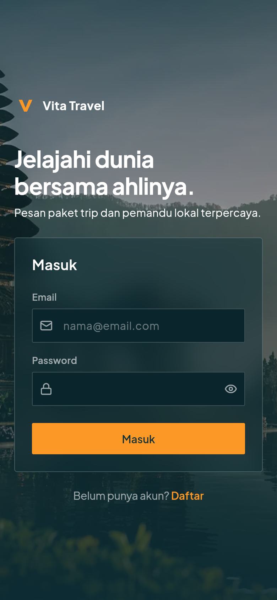

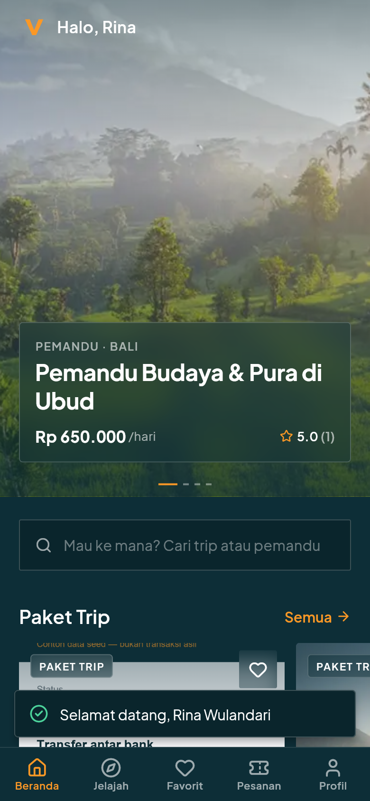

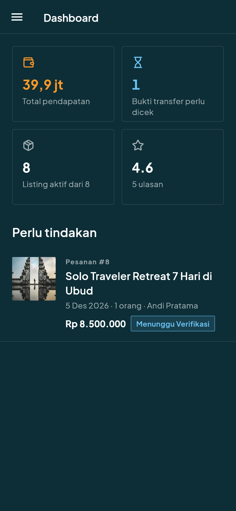

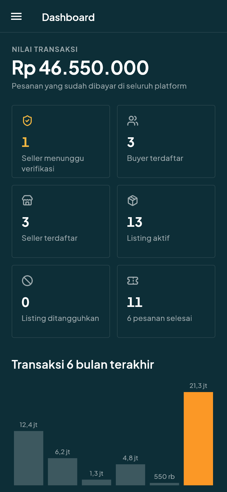

**B. Website Company Profile**

| Gambar | Keterangan |
| --- | --- |
| Gambar 5.5 | Halaman utama website — bagian pembuka beserta bilah navigasi |
| Gambar 5.6 | Halaman paket retreat — salah satu halaman detail paket perjalanan |


Catatan: tangkapan layar halaman yang memerlukan proses tertentu — form pemesanan, halaman unggah
bukti transfer, form tambah listing, serta halaman verifikasi seller dan moderasi listing pada sisi
admin — akan dilengkapi menyusul bersama dokumentasi penyebaran, karena alur tersebut paling jelas
diperlihatkan melalui percobaan langsung oleh penguji.

---

*Dokumen ini disusun berdasarkan kondisi nyata proyek pada 15 November 2026. Setiap angka yang
disebutkan — jumlah endpoint, jumlah tabel, jumlah kasus uji, dan ukuran kode — diambil dari
pemeriksaan langsung terhadap berkas proyek, bukan dari perkiraan. Bagian penyebaran basis data juga
ditulis dari hasil pemeriksaan langsung terhadap server Aiven, bukan dari rancangan.*
